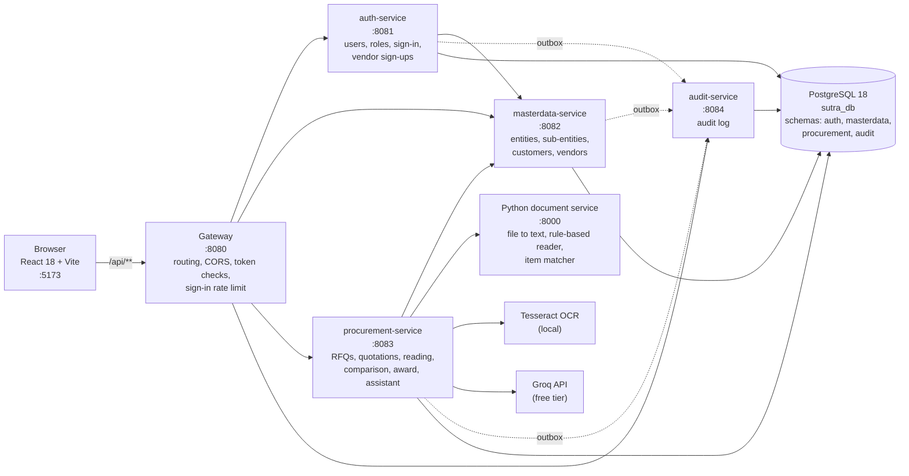
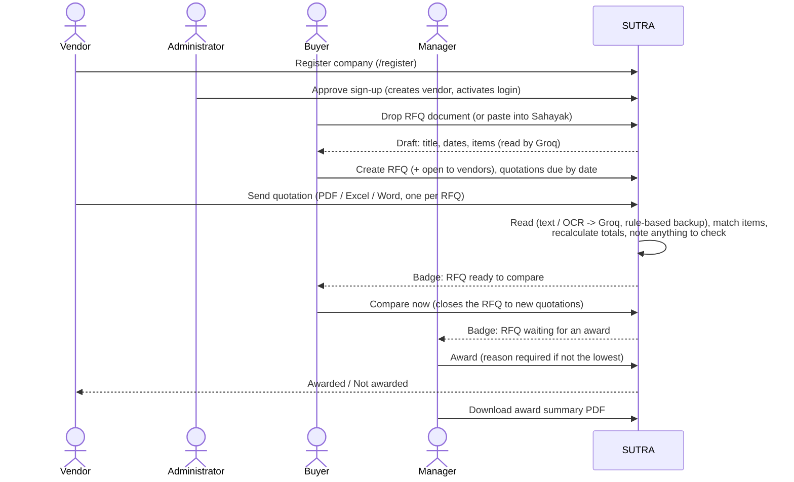
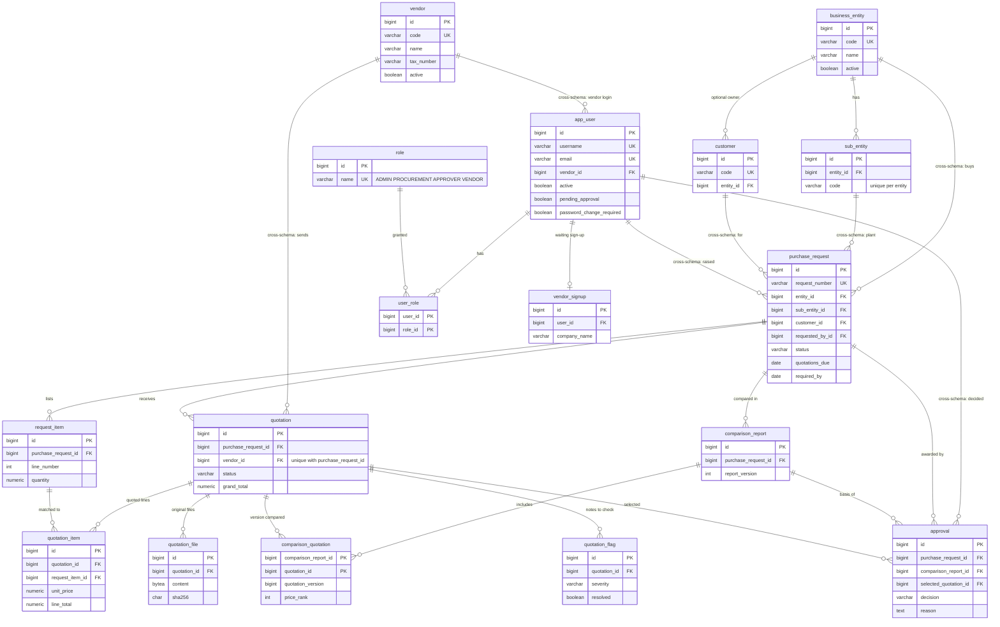

# SUTRA architecture

## System



* The browser talks only to the gateway. The gateway checks each token's signature and that the user is still active
  and unchanged, limits sign-in and vendor sign-up to 20 requests a minute per IP address, and never forwards
  `/internal/**` (service-to-service calls, signed with short-lived service tokens).
* Every service owns one schema and applies it with Flyway from `database/<service>/`. References into another
  service's schema are real foreign keys (see *Data model*), created by whichever service migrates last.
* Every change writes an audit event into the service's own `audit_outbox` table in the same transaction; a relay
  delivers it to the audit service, so no audit event is lost when the audit service is down.
* Groq only reads documents and answers questions. Every amount is recalculated in Java (`QuotationCalculator`,
  `BigDecimal`), and only a manager records an award.

## Main flow



## Data model

Solid lines are foreign keys inside one schema; the labels marked *cross-schema* are foreign keys between the
services' schemas (`database/masterdata/V2`, `auth/V4`, `procurement/V4`). All have `ON DELETE RESTRICT` (or
`CASCADE` for owned children such as items and files).



Also in every schema: `audit_outbox` (events waiting for delivery) and Flyway's `flyway_schema_history`; the audit
schema holds `audit_log`. Money is always `NUMERIC`; statuses, percentages, amounts and codes are guarded by `CHECK`
constraints; searched and joined columns are indexed.

## Code structure (each service)

```
com.sutra.<service>
  controller   REST endpoints (@RestController, @PreAuthorize)
  service      business rules and transactions
  repository   Spring Data JPA interfaces
  entity       JPA entities (BaseEntity, AuditableEntity are abstract) and enums
  request      validated input records (Bean Validation)
  response     output records (entities are never returned)
  exception    named exceptions (SutraException is the abstract base; one GlobalExceptionHandler in sutra-common)
  client       calls to other services (MasterDataClient, ProcurementClient)
  config / security / util / validation / calculation / ai   where a service needs them
```

Interfaces with more than one implementation: `QuotationExtractor` (Groq, rule-based), `ItemMatcher`,
`DocumentProcessingClient`.
