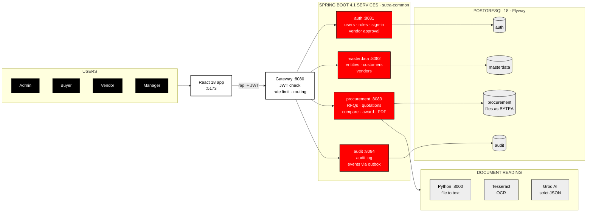
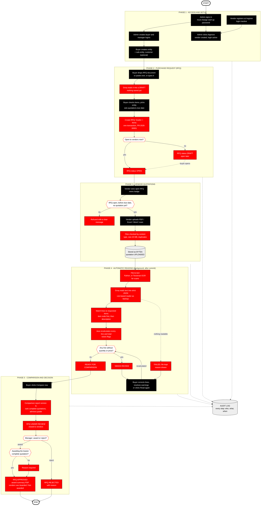
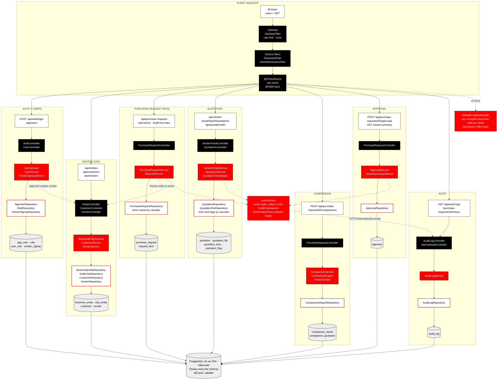
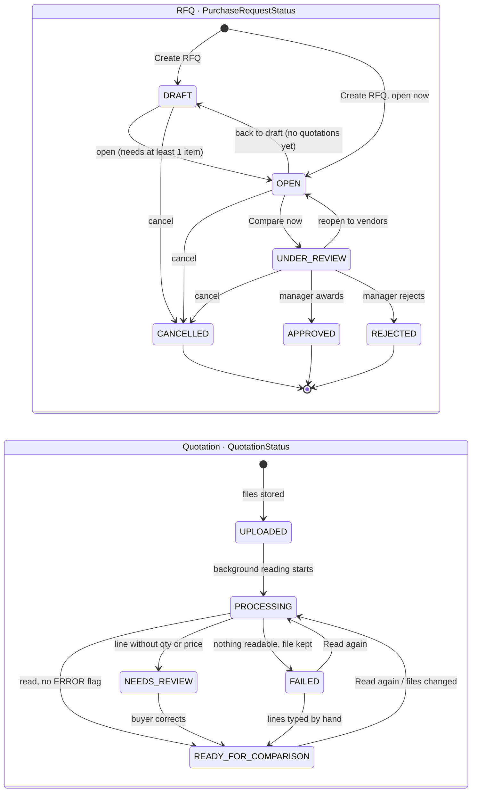

# SUTRA — Architecture Diagrams and Project Map

*Checked against the source code on 9 November 2026 (branch `sutra-v2`).*

This document is a visual map of SUTRA. It contains **six Mermaid diagrams**. Each diagram answers one level of the question "how does SUTRA work?", from who uses it down to how a row reaches PostgreSQL. Each diagram also exists as its own file in [`docs/diagrams/`](diagrams/), so you can open, render or export it on its own.

**Status labels used throughout**

| Label | Meaning |
| --- | --- |
| **Implemented** | In the code, reachable through an API, covered by tests |
| **Entity defined – no own API** | A table/entity exists but is only changed through its parent (by design) |
| **Planned feature** | Named in the project docs as future work; not in the code |

---

## 1. Project analysis summary

SUTRA is a **vendor quotation management system**:

- A **buyer** creates a request for quotation (RFQ).
- Approved **vendors** send quotations as PDF, Excel, Word or scanned files.
- The system **stores the original files**, **reads them** (Python + OCR + Groq AI, with a rule-based backup), **recalculates every total in Java**, and builds a **side-by-side comparison**.
- A **manager records the award**.
- Every change goes to an **audit log**.

**Rule of the project:** *AI reads, Java calculates, people decide.*

What I analysed:

| Area | Found in the code |
| --- | --- |
| Services | 5 Spring Boot services (gateway, auth, masterdata, procurement, audit) + shared library `sutra-common` + Python FastAPI service |
| JPA entities | 18 business entities + 1 technical entity (`AuditOutboxEvent`) |
| Database | PostgreSQL 18, 4 schemas, 22 tables, 30 foreign keys (11 across schemas), 42 CHECK, 18 UNIQUE |
| Controllers | 13 public REST controllers + 5 internal (service-to-service) + gateway proxy |
| Endpoints | About 70 public endpoints under `/api` |
| Repositories | 13 Spring Data JPA repositories (child rows such as items, lines and flags are saved through their parent by cascade) |
| Tests | 246 backend, 54 frontend, 38 Python, 75 acceptance checks |

**Corrections to the brief** (verified in code):

- **Customer is not an actor.** Customers have no login. A customer is master data: the end client an RFQ is for, optional on an RFQ.
- **"System User" is not a separate role.** There are exactly four roles: `ADMIN`, `PROCUREMENT` (Buyer), `APPROVER` (Manager), `VENDOR`.
- **`PurchaseRequestStatus` is an enum, not an entity.** It is stored as a column on `purchase_request`, guarded by a CHECK constraint.
- **Four extra entities exist** that the brief did not list:
  - `VendorSignup`: company details of a vendor waiting for approval.
  - `QuotationFlag`: notes and warnings to check on a quotation.
  - `ComparisonQuotation`: the link between a comparison report and each quotation, with rank and total.
  - `AuditOutboxEvent`: a technical table that guarantees audit delivery.

---

## 2. Identified actors

| Actor (role code) | Can access | Operations (Implemented) | Interacts with |
| --- | --- | --- | --- |
| **Administrator** (`ADMIN`) | Everything | Create/edit/deactivate/delete users and assign roles; approve or reject vendor sign-ups; everything a buyer and a manager can do, on any RFQ | AppUser, Role, VendorSignup, Vendor, all procurement entities, AuditLog |
| **Buyer** (`PROCUREMENT`) | Company pages | Manage entities, sub-entities, customers and vendor details; create RFQs (typed, from a dropped document, or pasted text); upload e-mailed quotations; correct quotations; compare | BusinessEntity, SubEntity, Customer, Vendor, PurchaseRequest, RequestItem, Quotation*, ComparisonReport |
| **Vendor** (`VENDOR`) | Vendor portal only | Self-register; edit own company profile; see open RFQs; submit one quotation per RFQ before the due date; withdraw it; download own files; see Awarded / Not awarded | VendorSignup, Vendor (own), PurchaseRequest (read), Quotation (own), QuotationFile (own) |
| **Manager** (`APPROVER`) | Company pages (read) + awards | Award or reject a compared RFQ (a reason is needed when the award is not the lowest; never on an RFQ the manager raised); download the award PDF; read the audit log | ComparisonReport, Approval, AuditLog |

The **system itself** acts in the background. It reads files, matches items, recalculates totals, raises flags and delivers audit events.

---

## 3. Identified modules

| Module | Service | Main classes | Status |
| --- | --- | --- | --- |
| Gateway and security | gateway | `GatewayFilter`, `PublicEndpointRateLimiter`, `TokenStateCache`, `RouteTable`, `ProxyController` | Implemented |
| Users, roles and sign-in | auth-service | `AuthController`, `UserController`, `AuthService`, `UserService`, `VendorSignupService`, `LoginAttemptService` | Implemented |
| Master data | masterdata-service | `EntityController`, `CustomerController`, `VendorController`, `VendorProfileController` + services | Implemented |
| Purchase request (RFQ) | procurement-service | `PurchaseRequestController`, `PurchaseRequestService`, `RfqDraftService` | Implemented |
| Quotation | procurement-service | `QuotationController`, `VendorPortalController`, `QuotationService`, `VendorPortalService`, `QuotationFileValidator` | Implemented |
| Document reading (AI) | procurement + Python | `QuotationProcessingService`, `ExtractionEngines`, `GroqQuotationExtractor`, `RulesQuotationExtractor`, `PdfOcrReader`, `HybridItemMatcher` | Implemented |
| Comparison | procurement-service | `ComparisonService`, `ComparisonEngine`, `QuotationCalculator`, `VendorGrader` | Implemented |
| Approval | procurement-service | `ApprovalService`, `AwardSummaryService` | Implemented |
| Audit | sutra-common + audit-service | `AuditService`, `AuditOutboxRelay`, `AuditLogService`, `AuditLogController` | Implemented |
| Dashboard, badges, assistant | procurement-service | `ReportingController`, `DashboardService`, `BadgeService`, `AssistantService` | Implemented |
| E-mail notifications, purchase orders, Docker/cloud deployment | — | — | **Planned feature** |

---

## 4. Identified entities

| # | Entity (table) | Schema | Primary key | Foreign keys | Status |
| --- | --- | --- | --- | --- | --- |
| 1 | `AppUser` (`app_user`) | auth | `id` | `vendor_id` → vendor (x-schema) | Implemented |
| 2 | `Role` (`role`) | auth | `id` | — | Implemented (fixed list, read-only) |
| 3 | join table `user_role` | auth | (`user_id`, `role_id`) | → app_user, → role | Entity defined – no own API (managed through AppUser) |
| 4 | `VendorSignup` (`vendor_signup`) | auth | `id` | `user_id` → app_user (unique) | Implemented |
| 5 | `BusinessEntity` (`business_entity`) | masterdata | `id` | — | Implemented |
| 6 | `SubEntity` (`sub_entity`) | masterdata | `id` | `entity_id` → business_entity | Implemented |
| 7 | `Customer` (`customer`) | masterdata | `id` | `entity_id` → business_entity (optional) | Implemented |
| 8 | `Vendor` (`vendor`) | masterdata | `id` | — | Implemented |
| 9 | `PurchaseRequest` (`purchase_request`) | procurement | `id` | entity, sub-entity, customer, `requested_by_id` (all x-schema) | Implemented |
| 10 | `RequestItem` (`request_item`) | procurement | `id` | → purchase_request | Implemented |
| 11 | `Quotation` (`quotation`) | procurement | `id` | → purchase_request; `vendor_id`, `uploaded_by_id` (x-schema) | Implemented |
| 12 | `QuotationFile` (`quotation_file`) | procurement | `id` | → quotation | Implemented |
| 13 | `QuotationItem` (`quotation_item`) | procurement | `id` | → quotation; → request_item (optional) | Implemented |
| 14 | `QuotationFlag` (`quotation_flag`) | procurement | `id` | → quotation; → quotation_item (optional); `resolved_by_id` | Implemented (created by the system, resolved by people) |
| 15 | `ComparisonReport` (`comparison_report`) | procurement | `id` | → purchase_request; `lowest_complete_quotation_id`; `generated_by_id` | Implemented |
| 16 | `ComparisonQuotation` (`comparison_quotation`) | procurement | (`comparison_report_id`, `quotation_id`) | → comparison_report, → quotation | Entity defined – no own API (saved with its report) |
| 17 | `Approval` (`approval`) | procurement | `id` | → purchase_request, → comparison_report, `selected_quotation_id`, `decided_by_id` | Implemented |
| 18 | `AuditLog` (`audit_log`) | audit | `id` (+ unique `event_id`) | — (stores names, not keys) | Implemented |
| 19 | `AuditOutboxEvent` (`audit_outbox`, one per schema) | every schema | `id` (+ unique `event_id`) | — | Technical – no API |

Enums stored as checked columns:

- `PurchaseRequestStatus`: DRAFT, OPEN, UNDER_REVIEW, APPROVED, REJECTED, CANCELLED
- `QuotationStatus`: UPLOADED, PROCESSING, NEEDS_REVIEW, READY_FOR_COMPARISON, FAILED
- `FlagSeverity`: INFO, WARNING, ERROR
- `ApprovalDecision`: APPROVED, REJECTED
- `ExtractionSource`: GROQ, RULES, MANUAL
- `FileFormat`: PDF, XLSX, XLS, DOCX
- `RoleName`: the four roles

---

## 5. Entity capabilities and use cases

Every operation listed below is **Implemented**. Where an operation is deliberately missing, the entry says so.

```text
APP_USER  (auth.app_user)
├── Purpose: one login, for staff or for a vendor company
├── Key fields: username, email, fullName, passwordHash (BCrypt), active, pendingApproval,
│               passwordChangeRequired, vendorId/vendorName, tokenVersion
├── Operations: sign in · view me · change password · create · view/search · update (incl. roles,
│               reset password) · deactivate · delete (refused while in use) · lock after 5 failures
├── Relationships: ↔ Role (Many-to-Many via user_role) · 1–1 VendorSignup · N–1 Vendor (vendor logins)
└── Business role: identity for every action; recorded as requestedBy / uploadedBy / decidedBy

ROLE  (auth.role)
├── Purpose: a permission group: ADMIN, PROCUREMENT, APPROVER, VENDOR
├── Operations: list (GET /users/roles) · assign to users. No create/edit/delete: the four roles are fixed
├── Relationships: ↔ AppUser (Many-to-Many)
└── Business role: decides which endpoints a user may call (@PreAuthorize)

VENDOR_SIGNUP  (auth.vendor_signup)
├── Purpose: company details of a vendor waiting for an administrator's approval
├── Operations: register (public, 20/min/IP) · list waiting · approve (creates Vendor, activates login) · reject (deletes)
├── Relationships: 1–1 AppUser
└── Business role: vendor onboarding; removed once approved

BUSINESS_ENTITY  (masterdata.business_entity)
├── Purpose: the company or plant that is buying
├── Operations: create (code generated from name) · view/search · update · delete (refused while used)
├── Relationships: 1–N SubEntity · 1–N Customer (optional) · 1–N PurchaseRequest (x-schema)
└── Business role: every RFQ belongs to one entity

SUB_ENTITY  (masterdata.sub_entity)
├── Purpose: a plant, department or branch inside an entity
├── Operations: create · list per entity · update · delete (refused while used)
├── Relationships: N–1 BusinessEntity · 1–N PurchaseRequest (optional)
└── Business role: narrows who inside the company is buying

CUSTOMER  (masterdata.customer)
├── Purpose: the end client the goods are bought for (no login)
├── Operations: create · view/search · update · delete (refused while used)
├── Relationships: N–1 BusinessEntity (optional) · 1–N PurchaseRequest (optional)
└── Business role: tags an RFQ with whom it serves

VENDOR  (masterdata.vendor)
├── Purpose: a supplier company
├── Operations: created by approving a sign-up (or by admin) · view/search · update · deactivate ·
│               delete (refused while quotations or logins exist) · vendor edits own profile
├── Relationships: 1–N Quotation (x-schema) · 1–N AppUser (vendor logins, x-schema)
└── Business role: who quotes; vendor isolation uses the vendorId inside the JWT

PURCHASE_REQUEST  (procurement.purchase_request)  = the RFQ
├── Purpose: what the company wants to buy, by when, in which currency
├── Key fields: requestNumber (PR-2026-00001), title, status, currency, requiredBy, quotationsDue
├── Operations: create · create with items in one step · draft from a dropped document or pasted text
│               (Groq, nothing saved) · view/search · update · delete (draft only) · open / back to draft /
│               cancel / reopen · compare · award summary PDF · history
├── Relationships: N–1 BusinessEntity, SubEntity, Customer, AppUser · 1–N RequestItem, Quotation,
│                  ComparisonReport, Approval
└── Business role: the centre of the workflow

REQUEST_ITEM  (procurement.request_item)
├── Purpose: one line the buyer wants (code, description, quantity > 0, unit, specifications)
├── Operations: add · update · delete (only while Draft/Open)
├── Relationships: N–1 PurchaseRequest · 1–N QuotationItem (matched lines)
└── Business role: the yardstick every quotation line is compared against

QUOTATION  (procurement.quotation)
├── Purpose: one vendor's offer for one RFQ (unique per RFQ + vendor)
├── Key fields: status, totals (calculated and as printed), terms, extractionSource/confidence, version
├── Operations: submit (vendor portal) · upload on behalf of vendor (buyer) · view · correct header ·
│               add/remove files · read again · delete · withdraw (vendor) · history
├── Relationships: N–1 PurchaseRequest, Vendor · 1–N QuotationFile, QuotationItem, QuotationFlag ·
│                  N–M ComparisonReport (via ComparisonQuotation) · selected by Approval
└── Business role: the thing being compared

QUOTATION_FILE  (procurement.quotation_file)
├── Purpose: the original file exactly as received (BYTEA), with name, type, size, SHA-256
├── Operations: upload (validated by content) · download (byte-for-byte) · remove
├── Relationships: N–1 Quotation
└── Business role: evidence; never changed

QUOTATION_ITEM  (procurement.quotation_item)
├── Purpose: one quoted line, read from the file or typed by a person
├── Operations: created by reading · add · update (marked manuallyEdited) · delete · recalculated in Java
├── Relationships: N–1 Quotation · N–1 RequestItem (the matched requested line)
└── Business role: the numbers the comparison uses

QUOTATION_FLAG  (procurement.quotation_flag)
├── Purpose: a note to check (INFO / WARNING / ERROR), e.g. "Warranty terms are incomplete"
├── Operations: raised by the system · resolve with a comment (warnings only; errors must be fixed)
├── Relationships: N–1 Quotation · N–1 QuotationItem (optional)
└── Business role: tells reviewers what is uncertain

COMPARISON_REPORT  (procurement.comparison_report)
├── Purpose: one saved version (1, 2, …) of the side-by-side comparison of an RFQ
├── Operations: generate ("Compare now") · list per RFQ · view one · CSV export (UI). No edit or delete
├── Relationships: N–1 PurchaseRequest · N–M Quotation (via ComparisonQuotation) · 1–N Approval
└── Business role: what the manager decides on

COMPARISON_QUOTATION  (procurement.comparison_quotation)
├── Purpose: which quotation (and which version of it) was in which report, its rank and total
├── Operations: saved together with its report (no own API)
└── Business role: proves exactly what data was compared

APPROVAL  (procurement.approval)
├── Purpose: the decision: APPROVED (with the selected quotation) or REJECTED, with reason, who, when
├── Operations: decide · list per RFQ · award summary PDF. No edit or delete (permanent record)
├── Relationships: N–1 PurchaseRequest, ComparisonReport, Quotation (selected)
└── Business role: the final, human step

AUDIT_LOG  (audit.audit_log)
├── Purpose: one recorded change (service, type, id, action, who, when, details)
├── Operations: receive events from the outbox (internal) · search all (admin, manager) · RFQ history ·
│               quotation history. Append-only: no edit or delete
└── Business role: accountability; who did what and when
```

---

## 6. Entity relationship analysis

| Relationship | Type (JPA mapping) | Why it is built this way |
| --- | --- | --- |
| AppUser ↔ Role | **Many-to-Many** (`@ManyToMany` through `user_role`) | A user holds roles and a role is shared by many users. A vendor login must have exactly the VENDOR role and nothing else |
| AppUser – VendorSignup | **One-to-One** (`@OneToOne`, unique `user_id`) | A waiting sign-up belongs to one login and disappears on approval |
| AppUser → Vendor | **Many-to-One** (`vendorId`, cross-schema FK) | Several logins can work for one vendor company |
| BusinessEntity → SubEntity | **One-to-Many** (`@OneToMany(mappedBy="entity")` / `@ManyToOne`) | A company has several plants; each plant belongs to one company |
| BusinessEntity → Customer | **One-to-Many**, optional (`@ManyToOne`) | A customer may be tied to one buying entity |
| Customer → PurchaseRequest | **One-to-Many**, optional (cross-schema FK; `@Embedded NamedRef` in Java) | An RFQ may be for one customer; a customer can have many RFQs |
| BusinessEntity / SubEntity → PurchaseRequest | **One-to-Many** (cross-schema FK; `NamedRef`) | Every RFQ belongs to one entity, optionally a sub-entity |
| PurchaseRequest → RequestItem | **One-to-Many** (`cascade = ALL`, `orphanRemoval`) | Items exist only inside their RFQ |
| PurchaseRequest → Quotation ← Vendor | **One-to-Many** on each side; unique (RFQ, vendor) | Many vendors quote on one RFQ; each vendor quotes once per RFQ |
| Quotation → QuotationFile / QuotationItem / QuotationFlag | **One-to-Many** | One offer can come as several files with many lines and notes |
| QuotationItem → RequestItem | **Many-to-One**, optional (`ON DELETE SET NULL`) | Each quoted line matches at most one requested line |
| ComparisonReport ↔ Quotation | **Many-to-Many** via `comparison_quotation` (`@EmbeddedId`) | A report compares many quotations; a quotation can appear in several report versions. The link row stores rank, total and the quotation version |
| PurchaseRequest → ComparisonReport | **One-to-Many** (unique RFQ + version) | Comparing again creates a new version; old ones are kept |
| PurchaseRequest / ComparisonReport / Quotation → Approval | **Many-to-One** each | A decision is about one RFQ, made on one report, choosing one quotation |
| Any change → AuditLog | **No foreign key** (outbox → HTTP → `audit_log`) | The audit service has its own schema and must keep history even after rows are deleted |

**Across services**, Java never joins entities from another schema. It keeps a small snapshot instead:

- `NamedRef` stores an id and a name.
- `UserRef` stores an id and a username.

PostgreSQL still enforces the ids with **real cross-schema foreign keys** (11 of them).

---

## 7. Complete business workflow

| # | Step | Actor | Status after | Implemented by |
| --- | --- | --- | --- | --- |
| 1 | First admin signs in and must change the start-up password | Admin | — | `DataInitializer`, `AuthService` |
| 2 | Admin creates staff logins (buyer, manager) | Admin | — | `UserService` |
| 3 | Vendors register at `/register`; admin approves (vendor row created, login activated) | Vendor, Admin | — | `VendorSignupService` |
| 4 | Buyer sets up the business structure: entity (+ sub-entity) and optional customer | Buyer | — | `BusinessEntityService`, `CustomerService` |
| 5 | Buyer drops the RFQ document or pastes text → AI draft (nothing saved) | Buyer | — | `RfqDraftService` |
| 6 | Buyer checks the draft and clicks **Create RFQ** (header + items in one transaction, optionally opened) | Buyer | RFQ DRAFT or OPEN | `PurchaseRequestService.createWithItems` |
| 7 | Vendors see the open RFQ (menu badge) and submit one quotation each before the due date | Vendor | Quotation UPLOADED | `VendorPortalService.submit` |
| 8 | Files are validated by content and stored as BYTEA | System | — | `QuotationFileValidator`, `QuotationService.storeFiles` |
| 9 | After the upload commits, the files are read in the background: file → text (Python, or OCR for scans) → Groq strict JSON (rules as backup) | System | PROCESSING | `QuotationProcessingService`, `ExtractionEngines` |
| 10 | Lines are matched to request items, totals recalculated in Java, flags raised | System | READY_FOR_COMPARISON (NEEDS_REVIEW / FAILED if needed) | `HybridItemMatcher`, `QuotationCalculator`, `QuotationReviewService` |
| 11 | Optional: buyer corrects lines or header, resolves warnings, or clicks "Read again" | Buyer | Recomputed | `QuotationService` |
| 12 | Buyer clicks **Compare now** → versioned comparison report; RFQ closed to vendors | Buyer | RFQ UNDER_REVIEW | `ComparisonService`, `ComparisonEngine`, `VendorGrader` |
| 13 | Manager awards (reason needed if not the lowest) or rejects | Manager | RFQ APPROVED / REJECTED | `ApprovalService` |
| 14 | Award summary PDF; vendors see Awarded / Not awarded | Manager, Vendor | — | `AwardSummaryService`, `VendorPortalService` |
| 15 | Every step above wrote an audit event → audit log, RFQ History tab | System | — | `AuditService` → `AuditOutboxRelay` → `AuditLogService` |

---

## 8. Recommended diagram strategy

**Recommended technology: Mermaid.**

| Option | Readability | Renders in VS Code / GitHub | Editing | Verdict |
| --- | --- | --- | --- | --- |
| **Mermaid** | Good; subgraphs and styles | GitHub natively; VS Code with one extension; mermaid.live online | Plain text in the repo | **Chosen**: no installation, renders where you already work |
| PlantUML | Very good for UML | Needs Java + Graphviz or a PlantUML server | Plain text | Heavier setup for the same result |
| Structurizr DSL | Excellent C4 architecture | Needs Structurizr Lite (Docker) or cloud | Plain text | Great for architecture, weak for workflow and entity details |
| Graphviz | Precise layout | Needs Graphviz installed | Low-level syntax | Hard to maintain |

**Why six diagrams and not one:** one diagram with 19 entities, 13 controllers, 13 repositories and a 15-step workflow cannot be read on a slide. Each diagram below answers one level:

| Level | Question | Diagram |
| --- | --- | --- |
| 1–2 | Who uses SUTRA, and what modules exist? | **D1** High-level system architecture |
| 3–4 | What can each entity do, and how are they connected? | **D2** Entity capability and relationship map |
| — | What happens, step by step, from setup to award? | **D3** Complete business workflow |
| 5 | How does an API call reach PostgreSQL? | **D4** Backend request flow, per module |
| — | How exactly are quotations compared? | **D5** Quotation processing and comparison flow |
| 6 | Which statuses can an RFQ and a quotation have? | **D6** Status lifecycles |

**Colour key (the same in every diagram):**

- Black boxes: people and actors.
- Red boxes: modules, services and processing steps.
- White boxes with a red border: entities and tables.
- Grey boxes: storage and external helpers.
- Dashed red boxes: decisions.

---

## 9. Complete diagram code

### D1 — High-level system architecture



### D2 — Entity capability and relationship map

```mermaid
%% D2 · ENTITY CAPABILITY AND RELATIONSHIP MAP
%% Every box = one JPA entity / table: PURPOSE, then OPERATIONS (all Implemented unless noted).
%% Arrow labels = relationship type. Dotted arrows cross service schemas (real cross-schema FKs).
flowchart LR

  %% ---------- AUTH SCHEMA ----------
  subgraph AUTH["auth-service · schema auth"]
    direction TB
    USER["<b>APP_USER</b><br/>Purpose: one login, staff or vendor<br/>Ops: sign in · create · view · update<br/>deactivate · delete · change password<br/>lock after 5 failures"]
    ROLE["<b>ROLE</b><br/>Purpose: ADMIN · PROCUREMENT<br/>APPROVER · VENDOR<br/>Ops: list · assign to users<br/>(fixed set, no create/delete)"]
    SIGNUP["<b>VENDOR_SIGNUP</b><br/>Purpose: vendor waiting for approval<br/>Ops: register · list · approve · reject"]
  end

  %% ---------- MASTERDATA SCHEMA ----------
  subgraph MASTER["masterdata-service · schema masterdata"]
    direction TB
    ENTITY["<b>BUSINESS_ENTITY</b><br/>Purpose: company or plant that buys<br/>Ops: create (code from name) · view<br/>search · update · delete if unused"]
    SUB["<b>SUB_ENTITY</b><br/>Purpose: plant or department<br/>Ops: create · list · update · delete"]
    CUST["<b>CUSTOMER</b><br/>Purpose: end client the goods are for<br/>Ops: create · view · search<br/>update · delete if unused"]
    VENDOR["<b>VENDOR</b><br/>Purpose: supplier company<br/>Ops: created on approval · view · update<br/>deactivate · delete · own profile edit"]
  end

  %% ---------- PROCUREMENT SCHEMA ----------
  subgraph PROC["procurement-service · schema procurement"]
    direction TB
    PR["<b>PURCHASE_REQUEST (RFQ)</b><br/>Purpose: what to buy, by when<br/>Ops: create · create with items · AI draft<br/>view · update · delete draft · open<br/>cancel · reopen · history"]
    RI["<b>REQUEST_ITEM</b><br/>Purpose: one requested line<br/>Ops: add · update · delete<br/>(only while Draft or Open)"]
    Q["<b>QUOTATION</b><br/>Purpose: one vendor's offer, one per RFQ<br/>Ops: submit · upload for vendor · view<br/>correct header · read again · withdraw<br/>delete · history"]
    QF["<b>QUOTATION_FILE</b><br/>Purpose: original file, BYTEA<br/>Ops: upload (checked) · download<br/>remove · never edited"]
    QI["<b>QUOTATION_ITEM</b><br/>Purpose: one quoted line with price<br/>Ops: read by AI · add · update<br/>delete · recalculated in Java"]
    QFL["<b>QUOTATION_FLAG</b><br/>Purpose: note to check<br/>INFO · WARNING · ERROR<br/>Ops: raised by system · resolve"]
    CR["<b>COMPARISON_REPORT</b><br/>Purpose: versioned side-by-side result<br/>Ops: generate · list · view · CSV<br/>(never edited)"]
    CQ["<b>COMPARISON_QUOTATION</b><br/>Purpose: quotation in a report<br/>rank · total · version compared<br/>(saved with report, no own API)"]
    AP["<b>APPROVAL</b><br/>Purpose: the decision, who, when, why<br/>Ops: award or reject · list<br/>award PDF · never edited"]
  end

  %% ---------- AUDIT SCHEMA ----------
  subgraph AUD["audit-service · schema audit"]
    direction TB
    LOG["<b>AUDIT_LOG</b><br/>Purpose: one recorded change<br/>Ops: receive from outbox · search<br/>RFQ history · quotation history<br/>(append-only)"]
  end

  %% ---------- RELATIONSHIPS ----------
  USER <-->|"Many-to-Many<br/>via user_role"| ROLE
  USER ---|"One-to-One"| SIGNUP
  USER -.->|"Many-to-One<br/>vendor login"| VENDOR
  SIGNUP -.->|"approve creates"| VENDOR

  ENTITY -->|"One-to-Many"| SUB
  ENTITY -->|"One-to-Many<br/>optional"| CUST

  ENTITY -.->|"One-to-Many"| PR
  SUB -.->|"One-to-Many<br/>optional"| PR
  CUST -.->|"One-to-Many<br/>optional"| PR
  USER -.->|"requested by"| PR

  PR -->|"One-to-Many<br/>cascade"| RI
  PR -->|"One-to-Many"| Q
  VENDOR -.->|"One-to-Many<br/>one per RFQ"| Q
  Q -->|"One-to-Many"| QF
  Q -->|"One-to-Many"| QI
  Q -->|"One-to-Many"| QFL
  QI -->|"Many-to-One<br/>matched line"| RI
  QFL -.->|"optional line"| QI

  PR -->|"One-to-Many<br/>version 1, 2..."| CR
  CR -->|"One-to-Many"| CQ
  CQ -->|"Many-to-One"| Q
  PR -->|"One-to-Many"| AP
  CR -->|"decided on"| AP
  AP -->|"selected quotation"| Q

  PROC ==>|"every change: audit event<br/>outbox, then HTTP"| LOG
  MASTER ==> LOG
  AUTH ==> LOG

  %% ---------- STYLES ----------
  classDef entity fill:#ffffff,color:#000000,stroke:#ff0000,stroke-width:2px
  classDef link fill:#ffffff,color:#000000,stroke:#000000,stroke-dasharray:4 3
  classDef core fill:#ffffff,color:#000000,stroke:#ff0000,stroke-width:4px
  class USER,ROLE,SIGNUP,ENTITY,SUB,CUST,VENDOR,RI,QF,QI,QFL,CR,AP,LOG entity
  class CQ link
  class PR,Q core
```



### D3 — Complete business workflow



### D4 — Backend request flow (API → Controller → Service → Repository → Table)



### D5 — Quotation processing and comparison flow

```mermaid
%% D5 · QUOTATION PROCESSING AND COMPARISON
%% From one RFQ with several vendors to the manager's decision, with the exact rules the code applies.
flowchart TB

  PR["<b>PURCHASE REQUEST</b><br/>PR-2026-00001 · OPEN<br/>5 request items"]

  subgraph VENDORS["MULTIPLE VENDORS (one quotation each, unique RFQ + vendor)"]
    direction LR
    V1["Vendor A<br/>PDF + Excel"]
    V2["Vendor B<br/>PDF + Excel"]
    V3["Vendor C<br/>scanned PDF"]
  end

  subgraph STORE["STORE (QuotationService)"]
    direction LR
    F1["Validate by content<br/>magic bytes · Office structure<br/>20 MB · max 10 files · SHA-256"]
    F2[("quotation_file<br/>BYTEA, original kept")]
  end

  subgraph READ["READ (QuotationProcessingService, @Async after commit)"]
    direction TB
    X1["Text: Python /parse<br/>Scans: PDFBox + Tesseract OCR"]
    X2["Groq strict JSON schema<br/>model fallback on rate limit"]
    X3["Rule-based reader<br/>if Groq fails or finds nothing"]
    X4["HybridItemMatcher<br/>item code, then description"]
    X5[("quotation_item<br/>extraction and match confidence")]
  end

  subgraph CHECK["CHECK (Java, BigDecimal, HALF_UP)"]
    direction TB
    K1["QuotationCalculator<br/>qty x price - discount + tax = line total<br/>sum = grand total"]
    K2["Compare with printed totals<br/>difference becomes a flag"]
    K3["QuotationValidator + TermsCheck<br/>missing items · terms · validity<br/>confidence below 0.75 or match below 0.6"]
    K4[("quotation_flag<br/>INFO · WARNING · ERROR")]
  end

  READY["READY FOR COMPARISON<br/>(buyer may correct first)"]

  subgraph COMPARE["COMPARE (ComparisonService + ComparisonEngine)"]
    direction TB
    G1["Per requested item: one cell per vendor<br/>quoted price or MISSING"]
    G2["Effective unit price = line total / quoted qty<br/>comparable total = price x REQUESTED qty"]
    G3{{"Complete? every item priced<br/>in the RFQ currency"}}
    G4["Price rank 1, 2, 3<br/>% above lowest"]
    G5["Shown, not ranked<br/>with the reason"]
    G6["VendorGrader, advisory 100 points<br/>price 40 · coverage 15 · delivery 10<br/>payment 10 · warranty 10 · validity 10 · notes 5"]
  end

  REPORT[("<b>COMPARISON REPORT</b> version N<br/>+ comparison_quotation rows<br/>rank · total · quotation version")]

  subgraph DECIDE["DECIDE (ApprovalService, Manager only)"]
    direction TB
    D1{{"Approve or reject?"}}
    D2["Approve lowest complete<br/>reason optional"]
    D3["Approve another<br/>reason REQUIRED"]
    D4["Reject<br/>reason"]
    D5[("<b>APPROVAL</b><br/>decision · quotation · reason<br/>decided by · decided at")]
  end

  PR --> V1
  PR --> V2
  PR --> V3
  V1 --> F1
  V2 --> F1
  V3 --> F1
  F1 --> F2 --> X1 --> X2
  X2 -.->|"fails"| X3
  X2 --> X4
  X3 --> X4
  X4 --> X5 --> K1 --> K2 --> K3 --> K4 --> READY
  READY --> G1 --> G2 --> G3
  G3 -->|"yes"| G4
  G3 -->|"no"| G5
  G4 --> G6
  G5 --> G6
  G6 --> REPORT --> D1
  D1 --> D2
  D1 --> D3
  D1 --> D4
  D2 --> D5
  D3 --> D5
  D4 --> D5

  classDef entity fill:#ffffff,color:#000000,stroke:#ff0000,stroke-width:3px
  classDef step fill:#ff0000,color:#ffffff,stroke:#000000
  classDef actor fill:#000000,color:#ffffff,stroke:#000000
  classDef data fill:#eeeeee,color:#000000,stroke:#000000
  classDef decision fill:#ffffff,color:#000000,stroke:#ff0000,stroke-width:2px,stroke-dasharray:5 3
  class PR,READY entity
  class F1,X1,X2,X3,X4,K1,K2,K3,G1,G2,G4,G5,G6,D2,D3,D4 step
  class V1,V2,V3 actor
  class F2,X5,K4,REPORT,D5 data
  class G3,D1 decision
```



### D6 — Status lifecycles



---

## 10. How to run or render the diagrams

| Where | How |
| --- | --- |
| **VS Code** | Install the extension **"Markdown Preview Mermaid Support"** (`bierner.markdown-mermaid`). Open this file and press `Ctrl+Shift+V`: all six diagrams draw. For a single `.mmd` file, the **"Mermaid Chart"** extension previews it |
| **GitHub** | Push the branch and open this file on GitHub; ```` ```mermaid ```` blocks render automatically |
| **Online** | Open https://mermaid.live, paste the contents of one file from `docs/diagrams/`, then use *Actions → PNG / SVG* to download a picture for the slides |
| **Command line** (optional) | `npx @mermaid-js/mermaid-cli -i docs/diagrams/d1-system-architecture.mmd -o d1.png -w 2400` |

Files:

- [`d1-system-architecture.mmd`](diagrams/d1-system-architecture.mmd)
- [`d2-entity-capability-map.mmd`](diagrams/d2-entity-capability-map.mmd)
- [`d3-business-workflow.mmd`](diagrams/d3-business-workflow.mmd)
- [`d4-backend-request-flow.mmd`](diagrams/d4-backend-request-flow.mmd)
- [`d5-quotation-comparison-flow.mmd`](diagrams/d5-quotation-comparison-flow.mmd)
- [`d6-status-lifecycles.mmd`](diagrams/d6-status-lifecycles.mmd)


**For slides:** export at width 2400 or more and use SVG where possible, so D2 and D4 stay sharp when you zoom.

---

## 11. Detailed diagram explanation

### D1 — High-level system architecture

| Part | What it is | Why it exists | Operations | Connects to | Place in the workflow |
| --- | --- | --- | --- | --- | --- |
| Actors | The four roles | Different people may do different things | See section 2 | React pages | Start of every action |
| React app | Single-page web app | One UI for staff and vendors; hides what a role cannot do | Forms, upload, tables, PDF download | Gateway only | Every step |
| Gateway | Single entry point on :8080 | Security and routing in one place; services stay hidden | Verify JWT, rate limit, block `/internal`, forward | All services | Every request |
| auth-service | Users, roles, sign-in | Identity is separate from business data | Sign in, users CRUD, sign-up approval | masterdata (create vendor), `auth` schema | Steps 1–3 |
| masterdata-service | Reference data | Entities, customers, vendors are shared by all RFQs | CRUD, vendor profile | procurement, `masterdata` schema | Step 4 |
| procurement-service | The core | RFQs, quotations, reading, comparison, approval | Section 5 | Python, OCR, Groq, `procurement` schema | Steps 5–14 |
| audit-service | History | An independent, append-only record | Receive, search | All services (via outbox) | Step 15 |
| sutra-common | Shared library | Same security, errors and audit code in every service | — | Every service | Everywhere |
| PostgreSQL | Database | One schema per service; constraints protect data | Store everything, including files | Each service's own schema | Every write |
| Python, Tesseract, Groq | Document helpers | Java alone cannot read scans or understand free text | File → text, OCR, AI reading | procurement only | Steps 5, 9 |

### D2 — Entity capability map

- **What it is:** every table drawn as a box with its *purpose* and the *operations* the code allows, plus the type of every relationship.
- **Why it exists:** it answers "what does this entity represent, and what can I do with it?"
- **How to read it:** start at **PURCHASE_REQUEST**, the thick red box in the centre:
  - to its **left** is who and what it belongs to (entity, customer, user);
  - **below** it are its items;
  - to its **right** are the quotations, their files, lines and flags, then the comparison and the approval.
- Arrows into **AUDIT_LOG** show that every service feeds the audit trail.
- **Highlight:**
  - *User ↔ Role is many-to-many.*
  - *Quotation is unique per RFQ + vendor.*
  - *ComparisonQuotation turns Report ↔ Quotation into a many-to-many with extra columns.*
  - *Approval and ComparisonReport are never edited.*

### D3 — Business workflow

- **What it is:** the full life of an RFQ in five phases (setup, RFQ, quotations, automatic reading, comparison and decision).
- **Colours:**
  - black = a person acts;
  - red = the system acts;
  - dashed = a rule that decides the path (due date, missing price, lowest quotation).
- **Why it exists:** it shows where people act and where automation takes over, and where the business rules decide the path.
- **Highlight:**
  - *The draft writes nothing.*
  - *Reading starts only after the upload is saved.*
  - *A quotation with a problem loops back through correction.*
  - *Compare closes the RFQ.*
  - *A reason is required when the award is not the lowest.*

### D4 — Backend request flow

- **What it is:** the real classes behind each module, from API to table, after the common path through gateway → filters → role check.
- **Why it exists:** it answers "how does an API request reach PostgreSQL?" with names you can open in the IDE.
- **Highlight the cross-cutting boxes:**
  - **GlobalExceptionHandler**: one error format, with rollback.
  - **AuditService/outbox**: the audit event is saved in the same transaction and delivered later.
  - The dotted calls between services: the RFQ service checks the entity in masterdata; approving a sign-up creates the vendor.

### D5 — Comparison flow

- **What it is:** the exact processing pipeline: store → read → check → compare → decide.
- **Why it exists:** comparison is the core logic examiners ask about.
- **Highlight:**
  - Java recalculates; the AI does not.
  - Prices are scaled to the **requested** quantity.
  - Only **complete, same-currency** quotations are ranked.
  - The grade is advisory.
  - Only the manager decides, with a reason when not choosing the lowest.

### D6 — Status lifecycles

- **What it is:** every legal status change for an RFQ and a quotation, taken from `MANUAL_TRANSITIONS` in `PurchaseRequestService`, `ApprovalService`, `ComparisonService` and `QuotationProcessingService`.
- **Why it exists:** most business rules are status rules. For example, items can be edited only while Draft/Open, and vendors can submit only while Open.

---

## 12. Entity capability cheat sheet

| Entity | Purpose | Main operations | Connected to | Important concept |
| --- | --- | --- | --- | --- |
| AppUser | A login | Sign in, CRUD, deactivate, change password, lock-out | Role, VendorSignup, Vendor, RFQ/approval (as actor) | BCrypt, JWT, token version |
| Role | Permission group (4 fixed) | List, assign | AppUser | Many-to-many, `@PreAuthorize` |
| VendorSignup | Vendor waiting for approval | Register, approve, reject | AppUser, Vendor (on approval) | One-to-one, self-service onboarding |
| BusinessEntity | Buying company or plant | CRUD, code generated | SubEntity, Customer, RFQ | One-to-many, delete refused while used |
| SubEntity | Plant or department | CRUD | BusinessEntity, RFQ | Unique code per entity |
| Customer | End client | CRUD | BusinessEntity, RFQ | Optional relationship |
| Vendor | Supplier | View, update, deactivate, delete, own profile | Quotation, AppUser | Cross-schema FK, vendor isolation by token |
| PurchaseRequest | The RFQ | Create (+ items, AI draft), CRUD, status changes, compare, award PDF | Almost everything | Aggregate root, state machine, `@Transactional` |
| RequestItem | Requested line | Add, update, delete while Draft/Open | RFQ, QuotationItem | Cascade + orphan removal |
| Quotation | One vendor's offer | Submit, upload, correct, read again, withdraw, delete | RFQ, Vendor, files, items, flags, reports, approval | Unique (RFQ, vendor), `@Version` optimistic lock |
| QuotationFile | Original file | Upload, download, remove | Quotation | BYTEA, magic bytes, SHA-256 |
| QuotationItem | Quoted line | Read by AI, add, edit, delete | Quotation, RequestItem | Confidence, `manuallyEdited`, BigDecimal |
| QuotationFlag | Note to check | Raised, resolved | Quotation, QuotationItem | Severity; errors block, warnings inform |
| ComparisonReport | Saved comparison version | Generate, view | RFQ, Quotation (via link), Approval | Versioning, JSON result |
| ComparisonQuotation | Quotation inside a report | Saved with report | Report, Quotation | Many-to-many with extra columns, `@EmbeddedId` |
| Approval | Final decision | Decide, list, PDF | RFQ, Report, Quotation | Separation of duties, reason rule |
| AuditLog | One recorded change | Receive, search, history | All services (no FK) | Outbox pattern, append-only, idempotent `event_id` |

---

## 13. Presentation guide

| Slide | Diagram | What to say | Connections to highlight |
| --- | --- | --- | --- |
| Architecture | **D1** | "Four roles use one React app. Every call passes the gateway, which checks the token and routes it to one of four services. Each service owns its schema in PostgreSQL. Python, Tesseract and Groq only help read documents." | Gateway as the only door; one schema per service; AI box only touches procurement |
| Database / entities | **D2** | "The RFQ is the centre. It has items and receives one quotation per vendor. Each quotation keeps its original files, its lines and its notes. Comparisons are versioned, and the approval records who chose which quotation and why." | User↔Role M:N; RFQ→Quotation←Vendor; QuotationItem→RequestItem; Report↔Quotation M:N; dotted cross-schema FKs |
| Workflow | **D3** | Walk the five phases with the test-pack story (Shakti, Pioneer, Vertex). | The draft saves nothing; background reading; the correction loop; Compare closes the RFQ; the reason rule |
| Technical design | **D4** | "Every module follows controller → service → repository → table. Errors go to one handler; audit events are saved in the same transaction." | Show one chain in the IDE live, e.g. `QuotationController` → `QuotationService` → `QuotationRepository` |
| Core logic | **D5** | "AI reads, Java calculates, people decide." | Price scaled to the requested quantity; only complete quotations ranked; advisory grade |
| Rules (backup slide) | **D6** | Use it when asked "what happens if…" | Items editable only Draft/Open; reopen; FAILED → Read again |

**Questions an examiner may ask from these diagrams:**

- Why is Customer not connected to Quotation?
- Why do dotted lines cross schemas?
- What happens if Groq is down?
- Why is there no edit on Approval?
- Why does the gateway block `/internal`?
- What does `comparison_quotation.quotation_version` prove?

---

## 14. Project-specific viva questions

| Question | Short answer | Detailed answer |
| --- | --- | --- |
| Why does PurchaseRequest have RequestItems? | One RFQ asks for several things. | Normalisation: each line is a row (`request_item`) with its own quantity > 0, unit and specs. It is `@OneToMany(cascade=ALL, orphanRemoval=true)`, so items live and die with the RFQ. Quotation lines match to these rows, which makes a per-item comparison possible. |
| Why can one request have multiple quotations? | Competition: several vendors bid on the same need. | `quotation.purchase_request_id` is many-to-one. The unique key (`purchase_request_id`, `vendor_id`) allows many vendors but only one quotation each, checked in `QuotationService` and by PostgreSQL. |
| Why is Quotation connected to Vendor? | To know who offered what, and to isolate vendors. | `vendor_id` is a cross-schema FK to `masterdata.vendor`, stored in Java as `NamedRef(id, name)`. The vendor portal filters by the `vendorId` inside the JWT, so a vendor can never see another vendor's quotation or files. |
| Why are QuotationFiles separate from Quotation? | One quotation can have several files, and the bytes are heavy. | One-to-many (a PDF plus an Excel list). The files are never changed, while the quotation's data can be corrected. Lists use a projection without the bytes for speed. A CHECK keeps `size_bytes = octet_length(content)`. |
| Why is ComparisonReport needed? | To freeze exactly what was compared when the decision was made. | Data can be corrected after comparing. The report stores the result as JSON plus `comparison_quotation` rows with the **quotation version** (`@Version`), so the approval always points to a fixed, versioned picture. Re-comparing creates version N+1. |
| Why is Approval a separate entity? | A decision is its own fact: who decided, when, what, why. | It links the RFQ, the report it was based on and the selected quotation. It is never edited (a permanent record). Rules: manager or admin only, not on one's own RFQ, reason required if not the lowest, and the report must be the latest. |
| Why is AuditLog important? | Accountability: every change can be traced. | Each service writes an `audit_outbox` row in the same transaction as the change; `AuditOutboxRelay` sends it to audit-service. Duplicates are ignored by `event_id`. The log keeps names rather than FKs, so history survives deletes. |
| Why did you use User and Role separately? | Roles are shared and fixed; users change. | Many-to-many via `user_role` avoids repeating role text. A role check is one annotation (`@PreAuthorize(Roles.BUYER)`). Changing roles bumps `tokenVersion`, so old tokens stop working. |
| Why is the Service layer required? | Business rules and transactions belong there, not in controllers. | Controllers only translate HTTP. Services hold the rules (due dates, one per vendor, reason required), `@Transactional` boundaries, record-level access (`RecordAccessPolicy`) and audit. The same service is reused by the vendor portal and by the buyer, and unit-tested with Mockito. |
| Why use Repository/JPA? | To work with objects, not hand-written SQL. | Spring Data generates CRUD and derived queries (`findByPurchaseRequestIdAndVendorId`); `@Query` is used where needed. Hibernate maps entities, `@Version` gives optimistic locking, and Flyway owns the schema (`ddl-auto: validate`). Repositories are interfaces, so they are easy to mock. |
| Why is Customer not linked to Quotation? | The customer belongs to the request, not to the vendor's offer. | A quotation reaches the customer through its RFQ (`quotation → purchase_request → customer`). Storing it twice would break normalisation. |
| Why does Role have no create/delete API? | The four roles are fixed by design. | Code depends on them (`RoleName` enum, `@PreAuthorize` expressions, a CHECK constraint). A new role needs code changes, so it is not a runtime operation. |
| What does the gateway add? | One secured entry point. | JWT verification, blocking `/internal/**`, rate-limiting public endpoints (20/min/IP), refusing deactivated users within 15 s (`TokenStateCache`) and routing by path, so the services are never exposed directly. |
| How does the complete quotation lifecycle work? | Upload → read → check → compare → decide. | Vendor uploads → validated by content → BYTEA (UPLOADED) → after commit, `@Async` reading (PROCESSING): text, Groq JSON or rules, matching, Java recalculation, flags → READY / NEEDS_REVIEW / FAILED → optional correction → Compare now (report version N, RFQ UNDER_REVIEW) → manager's approval → audit at every step. |
| What if the AI is wrong? | People see it and fix it; the maths is never trusted. | Totals are recalculated in Java and compared with the printed ones. Low confidence (< 0.75) or a weak match (< 0.6) raises a warning. Every line can be corrected (marked `manuallyEdited`), and the original file is always there to check against. |
