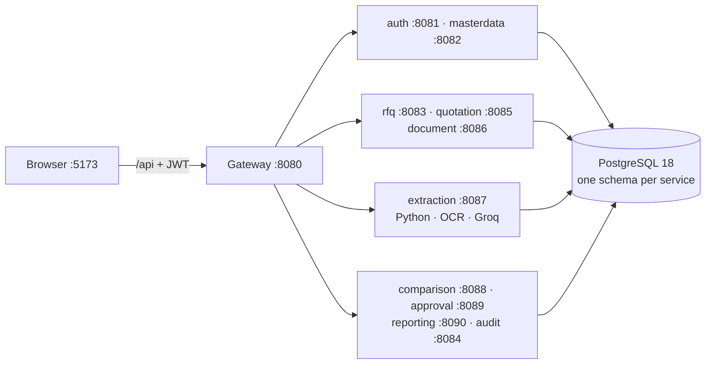

# SUTRA — Complete Project Explanation and Viva Guide

*As of 9 November 2026 · Harshit Gautam*

## How to use this guide

This guide explains SUTRA from the simplest idea down to the code, so you can present it and answer viva questions yourself. It is based only on the project as it stands: the source code in `frontend/`, `backend/`, `ai/` and `database/`, plus `README.md`, `docs/SPEC_COMPLIANCE.md` and `docs/diagrams/system-architecture.mmd`.

- **Implemented** means the code exists and is tested.
- **Not implemented** means it is not in the code; it is only a recommendation.
- Read layers 1–3 first (the idea and the flow), then 4–9 (how it is built), then 10–14 (the core logic), then 15–16 (presentation and viva).

One correction to the brief: in SUTRA a **customer does not create the RFQ**. A **buyer** (role PROCUREMENT) creates it. A customer is master data: the end client the goods are bought for, and it is optional on an RFQ.

### Contents

1. [Layer 1: Understanding SUTRA from the ground up](#layer-1-understanding-sutra-from-the-ground-up)
2. [Layer 2: Problem and solution](#layer-2-problem-and-solution)
3. [Layer 3: System workflow, step by step](#layer-3-system-workflow-step-by-step)
4. [Layer 4: System architecture](#layer-4-system-architecture)
5. [Layer 5: Folder and code structure](#layer-5-folder-and-code-structure)
6. [Layer 6: Database design](#layer-6-database-design)
7. [Layer 7: Java and OOP concepts](#layer-7-java-and-oop-concepts)
8. [Layer 8: Spring Boot concepts](#layer-8-spring-boot-concepts)
9. [Layer 9: API analysis](#layer-9-api-analysis)
10. [Layer 10: Quotation file management](#layer-10-quotation-file-management)
11. [Layer 11: Quotation comparison logic](#layer-11-quotation-comparison-logic)
12. [Layer 12: Security and data integrity](#layer-12-security-and-data-integrity)
13. [Layer 13: Testing](#layer-13-testing)
14. [Layer 14: Complete data flow, one realistic example](#layer-14-complete-data-flow-one-realistic-example)
15. [Layer 15: Presentation plan (15 slides)](#layer-15-presentation-plan-15-slides)
16. [Layer 16: Viva and interview questions](#layer-16-viva-and-interview-questions)
17. [Project cheat sheet](#project-cheat-sheet)

---

## Layer 1: Understanding SUTRA from the ground up

SUTRA helps a company's buying team collect quotations from many vendors, compare them fairly, and record who chose the winner and why. Its rule is: **AI reads the documents, the backend calculates, people decide.**

### What problem does it solve?

When a company needs to buy something (steel sheets, bearings, laptops), it sends a **request for quotation (RFQ)** to several vendors. Each vendor replies with a quotation, usually as a PDF, Excel sheet, Word file or a scanned page. Someone must read every file, copy prices into a spreadsheet, check the totals, notice missing terms, and pick a vendor. SUTRA automates the reading, checking and comparing, and keeps a permanent record of the decision.

### Why it matters

- **Money:** one wrong digit copied into Excel can make the wrong vendor look cheapest.
- **Time:** reading 3–10 quotations per RFQ by hand takes hours.
- **Accountability:** auditors ask "who chose this vendor, when, and why?". Email and spreadsheets cannot answer that reliably.

### Main objective

Give one place where an RFQ goes from creation to award, with: files stored exactly as received, data extracted automatically, every total recalculated by the system, a side-by-side comparison, and a recorded human decision with a full audit trail.

### Who uses it

| Role (code name) | What they do in SUTRA |
| --- | --- |
| Administrator (ADMIN) | Everything; creates logins for buyers and managers; approves vendor sign-ups |
| Buyer (PROCUREMENT) | Manages entities, sub-entities, customers; creates RFQs; compares quotations |
| Vendor (VENDOR) | Registers its company; sees open RFQs; sends one quotation per RFQ; sees the outcome |
| Manager (APPROVER) | Awards or rejects a compared RFQ (with a reason when not the lowest); reads the audit log |

### The idea in very simple words

Think of SUTRA as a smart tender box. The buyer posts what they need. Vendors drop their quotations into the box. SUTRA opens each one, reads the prices, checks the maths, and lays all of them side by side in one table. A manager looks at the table and picks the winner, and SUTRA writes down who picked it and why.

### A real-world example (the project's own test pack)

Axiom Auto Components needs 5 production materials (CRCA steel sheet, aluminium ingot, EPDM rubber, ball bearings, hex bolts) for its Chakan plant. Three vendors quote: Shakti Metals (₹37,02,250.00), Pioneer Industrial (₹37,23,962.00) and Vertex Auto (₹36,22,788.80). Vertex is cheapest, but its bearing warranty is "to be confirmed" and it asks for 50% advance. By hand, a buyer could miss both points. SUTRA ranks Vertex first, shows the open warranty as a note, lowers its advisory grade for the advance payment, and the manager decides with all of that visible. (Figures from `ai/test-data/README.txt`, verified by the acceptance test.)

**Key takeaways**

- SUTRA = RFQ → vendor quotations → automatic reading → comparison → human award → audit trail.
- Four roles: Administrator, Buyer, Vendor, Manager.
- AI never decides and never calculates money; Java does the maths and a person decides.

---

## Layer 2: Problem and solution

The manual process fails at four points (format chaos, retyping errors, missed terms, no decision record); SUTRA replaces each with an automated, checked step.

### The traditional, manual process

1. The buyer writes an RFQ in Word and emails it to vendors.
2. Vendors reply by email with PDF, Excel, Word or scanned quotations.
3. The buyer opens each file and retypes item prices, taxes and totals into Excel.
4. The buyer checks terms (delivery, payment, warranty, validity) by reading each file.
5. The buyer builds a comparison sheet and sends it to a manager.
6. The manager approves by email or signature; files stay in mailboxes.

### Problems and limitations

| Problem | Effect |
| --- | --- |
| Many file formats, some scanned | Every file is read by a person; scans cannot be copied at all |
| Retyping numbers | Typing errors change totals and the ranking |
| Trusting the vendor's printed total | A wrong printed total goes unnoticed |
| Terms buried in text | Missing warranty or a 50% advance is missed |
| Different item names per vendor | "Deep-groove bearing 6204" vs "Ball brg 6204-2RS" are hard to line up |
| Late quotations | No clear cut-off date |
| Decision in email | No reliable record of who decided, when and why |

### How SUTRA solves them

| Manual problem | SUTRA feature (implemented) |
| --- | --- |
| Formats and scans | Upload PDF, Excel, Word; scanned PDFs read by local Tesseract OCR |
| Retyping | Groq AI reads the text into a fixed JSON shape; a rule-based reader is the backup |
| Wrong printed totals | `QuotationCalculator` recalculates every line and total with `BigDecimal`; differences become notes |
| Missed terms | `QuotationValidator` and `TermsCheck` create flags such as "Warranty terms are incomplete" |
| Different item names | `HybridItemMatcher`: match by item code first, then by description similarity |
| Late quotations | "Quotations due by" date; the vendor portal refuses quotations after it |
| Decision in email | `approval` table (who, when, decision, reason) + `audit_log` of every change + award summary PDF |

### Input → processing → output

```
INPUT                         PROCESSING                                  OUTPUT
RFQ (typed or a dropped    →  validate file type/size/content          →  stored original files (BYTEA)
  document)                   file → text (Python / OCR)                  extracted quotation lines
Vendor quotation files        text → structured data (Groq / rules)       recalculated totals + notes
  (PDF / Excel / Word /       match lines to RFQ items                    side-by-side comparison report
   scanned PDF)               recalculate totals, raise flags             (ranking, advisory grade)
Manager's decision            compare quotations, rank, grade             approval record + audit log
                              record the decision                         award summary PDF
```

**Key takeaways**

- Manual pain: formats, retyping, wrong totals, missed terms, no record.
- SUTRA's answer for each: OCR + AI reading, backend recalculation, automatic flags, recorded approvals.
- Output is not "the best vendor"; it is a checked comparison plus a recorded human decision.

---

## Layer 3: System workflow, step by step

An RFQ moves Draft → Open → Under review (compared) → Approved or Rejected; quotations move Uploaded → Processing → Ready for comparison (or Needs review / Failed). Every step below names who acts, what data it touches and which code runs.

| # | Step | Who | What happens and what data is created | Backend components | What happens next |
| --- | --- | --- | --- | --- | --- |
| 1 | User / admin interaction | Everyone | Sign in returns a JWT token (8 h). Vendors self-register at `/register`; the admin approves. The first admin must change the start-up password. | `AuthController`, `AuthService`, `VendorSignupService`, `JwtCodec`, gateway `GatewayFilter` + rate limiter | The user lands on the dashboard (staff) or the vendor portal |
| 2 | Entity and sub-entity management | Buyer, admin | Creates `business_entity` (the company/plant buying) and optional `sub_entity` (plant/department). Only a name is needed; the code is generated (`AXIOMAUTOC`). Delete is refused while in use. | `EntityController`, `BusinessEntityService.codeFromName` | The entity is chosen on an RFQ |
| 3 | Customer management | Buyer, admin | Creates `customer` (end client), optionally linked to an entity. | `CustomerController`, `CustomerService` | Optional link on an RFQ |
| 4 | Vendor management | Vendor, admin | Vendor signs up (`vendor_signup`, inactive login); admin approves → `vendor` row created in masterdata, login activated and linked. Vendor edits its own contact/GST. | `VendorSignupService.approve` → `MasterDataClient.registerVendor` → `VendorService.register`; `VendorProfileController` | Vendor can see open RFQs |
| 5 | Purchase request (RFQ) creation | Buyer | Either types the RFQ or drops the RFQ document: `RfqDraftService` reads it with Groq into a draft (nothing saved). On "Create RFQ" one call saves `purchase_request` (number `PR-2026-00001`) plus items, and can open it. | `PurchaseRequestController` (`/draft-from-files`, `/draft-from-text`, `/with-items`), `PurchaseRequestService.createWithItems` | Status DRAFT or OPEN |
| 6 | Request items | Buyer | `request_item` rows: line number, optional item code, description, quantity, unit, specifications. Editable while Draft/Open. | `PurchaseRequestService.addItem/updateItem/deleteItem` | Opening requires at least one item |
| 7 | Vendor quotation submission | Vendor (or buyer for e-mailed ones) | One quotation per vendor per RFQ, before the "quotations due" date. Creates `quotation` (status UPLOADED). | `VendorPortalService.submit` or `QuotationService.upload` → `createQuotation` | Files are stored, reading is queued |
| 8 | File upload and storage | Same | Each file is validated (extension, magic bytes, Office structure, size ≤ 20 MB, duplicates by SHA-256) and stored as BYTEA in `quotation_file`. | `QuotationFileValidator`, `QuotationService.storeFiles` | After commit, an event starts reading in the background |
| 9 | Data extraction | System | File → text (Python `/parse`, or PDFBox + Tesseract OCR for scans) → Groq reads it into fixed JSON (`ExtractionSchema`); if Groq fails, the rule-based reader. Lines are matched to RFQ items. Creates `quotation_item` rows and flags. | `QuotationProcessingEvents` (`@Async`), `QuotationProcessingService`, `ExtractionEngines`, `GroqQuotationExtractor`, `RulesQuotationExtractor`, `PdfOcrReader`, `HybridItemMatcher` | Totals recalculated, status set |
| 10 | Manual correction and confidence | Buyer | Each line keeps `extraction_confidence` and `match_confidence`; reading confidence below 0.75 gives a LOW_CONFIDENCE flag, match confidence below 0.6 a LOW_MATCH_CONFIDENCE flag. The buyer can edit/add lines (`manually_edited = true`), fix the header, resolve warnings, or "Read again". A quotation is READY unless an ERROR (no quantity/price) is open. | `QuotationService.updateItem/addItem/resolveFlag/reprocess`, `QuotationReviewService.revalidate` | Ready quotations can be compared |
| 11 | Quotation comparison | Buyer | "Compare now" lines up all ready quotations per RFQ item, ranks complete ones by grand total, computes the advisory grade, lists missing information. | `ComparisonService.generate`, `ComparisonEngine`, `VendorGrader` | RFQ becomes UNDER_REVIEW; vendors can no longer submit |
| 12 | Comparison report generation | System | Saves `comparison_report` (version 1, 2…; result as JSON) and one `comparison_quotation` row per quotation (rank, total, quotation version compared). | `ComparisonService`, `ComparisonReportRepository` | Manager is notified by a menu badge |
| 13 | Approval / decision | Manager (or admin) | Records `approval`: APPROVED with the selected quotation, or REJECTED; a reason is required if not the lowest complete quotation; a manager cannot decide on an RFQ they raised. Award summary PDF available. | `ApprovalService.decide`, `AwardSummaryService` | RFQ becomes APPROVED/REJECTED; vendors see Awarded / Not awarded |
| 14 | Audit logging | System | Every change writes an event into the service's `audit_outbox` in the same transaction; `AuditOutboxRelay` delivers it to the audit service's `audit_log`. | `AuditService`, `AuditOutboxRelay`, `InternalAuditController`, `AuditLogService` | History tab and Audit log page |

**Key takeaways**

- Two state machines: RFQ (Draft → Open → Under review → Approved/Rejected) and quotation (Uploaded → Processing → Ready / Needs review / Failed).
- Reading runs in the background after the upload is committed (`@Async` + `@TransactionalEventListener`).
- Comparing closes the RFQ to vendors; only a manager awards; every step is audited.

---

## Layer 4: System architecture

SUTRA is a **microservice** system: a React frontend talks only to a **gateway**, which forwards each call to one of **five Spring Boot services**; each service owns **one PostgreSQL schema**, and a small **Python service** turns files into text.

### Overall architecture

```
Browser (React 18 + Vite, :5173)
        │  /api/** + JWT  (Vite dev proxy adds X-Forwarded-For)
        ▼
Gateway (:8080)  — GatewayFilter: block /internal, verify JWT, user still active?
        │          PublicEndpointRateLimiter: 20 sign-in/sign-up per minute per IP
        │          CorrelationIdFilter: X-Correlation-Id on every request
        │          RouteTable + ProxyController: forward by path (first match wins)
        ├── auth-service        :8081  users, roles, sign-in, vendor sign-ups          schema auth
        ├── masterdata-service  :8082  entities, sub-entities, customers, vendors      schema masterdata
        ├── rfq-service         :8083  RFQs and their items                            schema rfq
        ├── quotation-service   :8085  quotations, lines, notes, vendor portal         schema quotation
        ├── document-service    :8086  original files (content check, BYTEA)           schema document
        ├── extraction-service  :8087  reading jobs, RFQ drafts, the AI                schema extraction
        │       ├── Python FastAPI :8000 (file → text, rule reader, matcher)
        │       ├── Tesseract OCR (scanned PDFs)
        │       └── Groq API (AI reading, assistant answers)
        ├── comparison-service  :8088  versioned comparisons, ranking, vendor grade    schema comparison
        ├── approval-service    :8089  award / reject decisions                        schema approval
        ├── reporting-service   :8090  dashboard, badges, award PDF, assistant         (no database)
        └── audit-service       :8084  hash-chained audit log                          schema audit
All services share sutra-api (the contracts: enums, request/response records) and sutra-common
(security, errors, correlation id, service calls, audit outbox).
```

The same picture as a Mermaid diagram (renders on GitHub and in VS Code with a Mermaid extension):



The complete system diagram is [`diagrams/system-architecture.mmd`](diagrams/system-architecture.mmd) (paste it into
mermaid.live).

**Why microservices?** Each service owns one stage of the process and its data, can be started, tested and changed alone, and a failure in one (for example the AI) does not stop sign-in, RFQs or master data. The cost: calls between services over HTTP, and consistency rules for steps that span two services (for example comparison saves its report, then moves the RFQ with a compare-and-set call in the same transaction).

### Inside one Spring Boot service (layered architecture)

```
HTTP request
  → RequestIdFilter (gives every request an id for logs)
  → JwtAuthenticationFilter (reads the token → SutraUserPrincipal)
  → @PreAuthorize role check
  → Controller        (@RestController: reads JSON/params, @Valid, calls ONE service method)
  → Service           (@Service, @Transactional: business rules, record-level access, audit)
  → Repository        (Spring Data JPA interface: save, findById, custom @Query)
  → Entity            (@Entity class = one table row; Hibernate maps it)
  → PostgreSQL
  ← Response record (DTO) → JSON
  (any exception) → GlobalExceptionHandler → ApiError JSON
```

| Layer | Package | Responsibility | Example in SUTRA |
| --- | --- | --- | --- |
| Controller | `controller` | HTTP only: URL, method, input, status code | `PurchaseRequestController.create` |
| Service | `service` | Rules, transactions, calls to other services | `PurchaseRequestService.createWithItems` |
| Repository | `repository` | Database access through JPA | `QuotationRepository.findByPurchaseRequestIdAndVendorId` |
| Entity / model | `entity` (+ `enums`) | Java classes mapped to tables | `Quotation`, `QuotationStatus` |
| DTO request | `request` | Validated input records | `PurchaseRequestRequest` (`@NotBlank title`) |
| DTO response | `response` | Output records, never entities | `QuotationResponse.from(quotation, files)` |
| Utility | `util` (+ `sutra-common/util`) | Small shared helpers | `TextSimilarity`, `Money`, `Text.blankToNull` |
| Exception | `exception` + `sutra-common/error` | Named errors → one JSON shape | `QuotationNotFoundException` → 404 |
| Engines and clients | `service/internal`, `client`, `config` | AI reading, maths, file checks, record access, service clients, settings | `QuotationCalculator`, `RecordAccessPolicy` |

### Exception handling

Every business error is a subclass of the abstract `SutraException`, which carries an HTTP status and a code (for example `BusinessRuleException("DUE_DATE_IN_PAST", …)` → 422). One `@RestControllerAdvice`, `GlobalExceptionHandler` in sutra-common, turns every exception into the same `ApiError` JSON: `timestamp, status, error, code, message, path, fieldErrors, requestId`. Validation errors list each bad field; unknown errors become a 500 without leaking internals.

### How the layers and services communicate

- **Inside a service:** Spring dependency injection hands each class what it needs through its constructor.
- **Service to service:** HTTP calls to `/internal/**` endpoints with short-lived service tokens (`InternalRestClients`); the gateway never forwards `/internal`.
- **Background work:** after an upload commits, `QuotationProcessingEvents` (`@Async` + `@TransactionalEventListener`) reads the files on a separate thread.
- **Audit:** events go into each service's `audit_outbox` table in the same transaction, then `AuditOutboxRelay` posts them to the audit service.

**Key takeaways**

- Browser → gateway → one of five services → its own schema.
- Each service: controller → service → repository → entity, DTOs at the edges, one global exception handler.
- Services talk over HTTP with service tokens; audit events use the outbox pattern so none are lost.

---

## Layer 5: Folder and code structure

The repository has four code roots (frontend, backend, ai, database) plus docs and two start/stop scripts; inside the backend every service repeats the same package layout.

```
PROJECT SUTRA/
├── frontend/            React 18 + Vite UI (src/pages, src/components, src/api, src/hooks, src/utils)
├── backend/             Maven multi-module (backend/pom.xml)
│   ├── sutra-api/           contracts: status enums, request/response records, internal API records, shared rules
│   ├── sutra-common/        shared library: security, errors, correlation id, service calls, audit outbox
│   ├── gateway/             entry point :8080
│   ├── auth-service/        :8081
│   ├── masterdata-service/  :8082
│   ├── rfq-service/         :8083
│   ├── audit-service/       :8084
│   ├── quotation-service/   :8085
│   ├── document-service/    :8086
│   ├── extraction-service/  :8087
│   ├── comparison-service/  :8088
│   ├── approval-service/    :8089
│   └── reporting-service/   :8090
├── ai/                  Python FastAPI document reader + test data + acceptance script
├── database/            setup, reset and clean-up scripts (each service keeps its migrations in src/main/resources/db/migration)
├── docs/                SPEC_COMPLIANCE.md, ACCEPTANCE_RESULTS.md, diagrams/system-architecture.mmd, this guide
└── start-all.ps1 / stop-all.ps1
```

### sutra-common (used by every service)

| Class | Why it exists / responsibility | Without it |
| --- | --- | --- |
| `SutraException` (abstract) + `BusinessRuleException`, `DuplicateResourceException`, `ForbiddenOperationException`, `ResourceNotFoundException`, `ServiceUnavailableException` | One base for all business errors, each with HTTP status + code | Every service would invent its own error format |
| `GlobalExceptionHandler`, `ApiError` | Converts any exception into one JSON shape | Clients would get Spring's default error pages |
| `CommonSecurityConfig`, `JwtAuthenticationFilter`, `JwtCodec`, `SutraUserPrincipal`, `CurrentUserProvider`, `Roles`, `RoleName` | Stateless JWT security; `Roles.BUYER` etc. are the `@PreAuthorize` expressions | No authentication, or copy-pasted security in 5 places |
| `AuditService`, `AuditOutboxEvent`, `AuditOutboxRelay` | Write audit events in the same transaction, deliver later | Audit events lost when the audit service is down |
| `InternalRestClients`, `ServiceUrls` | HTTP clients that sign service tokens | Services could not call each other securely |
| `PageResponse`, `RequestIdFilter`, `ClockConfig`, `Money`, `Text` | Paging wrapper, request ids, testable clock, small helpers | Duplicated helper code |

### gateway

| Class | Responsibility |
| --- | --- |
| `GatewayFilter` | Blocks `/internal/**`, verifies JWT signature, refuses service tokens and users who were deactivated or changed, applies the rate limit |
| `PublicEndpointRateLimiter` | 20 requests per minute per IP on `/api/auth/login` and `/api/auth/register-vendor`; trusts `X-Forwarded-For` only from a local proxy |
| `TokenStateCache` | Caches each user's active flag + token version for 15 s (asks auth-service) |
| `RouteTable`, `ProxyController` | Picks the target service by path and streams the request/response |
| `ServiceStatusController` | `/api/system/services`: health of every service |

### auth-service

| Class | Responsibility | Used by |
| --- | --- | --- |
| `AuthController` | login, me, change-password, register-vendor | Frontend |
| `UserController` | user CRUD, roles, vendor sign-up list/approve/reject (ADMIN) | Users page |
| `AuthService` | Sign-in with `AuthenticationManager`, lock-out check, pending-approval message, JWT issue, password change | `AuthController` |
| `UserService` | Create/update/delete users; rules: vendor login needs exactly one vendor and no other role; no self-lock-out; waiting sign-ups cannot be edited | `UserController` |
| `VendorSignupService` | register (inactive + pending), approve (creates vendor via `MasterDataClient`, activates), reject (deletes) | Both controllers |
| `LoginAttemptService` | 5 failures → locked 15 min | `AuthService` |
| `DataInitializer` | Creates the first admin; flags "must change password" while it uses the start-up password | Startup |
| Entities `AppUser`, `Role`, `VendorSignup` | Tables of the auth schema | Repositories |

### masterdata-service

| Class | Responsibility |
| --- | --- |
| `EntityController` / `BusinessEntityService` | Entities + sub-entities CRUD; `codeFromName` makes unique codes; delete refused while sub-entities, customers or RFQs use it (`UsageClient` asks the RFQ and quotation services) |
| `CustomerController` / `CustomerService` | Customer CRUD, optional entity link |
| `VendorController` / `VendorService` | Vendor edit/deactivate/delete; `register` (from an approved sign-up); `updateProfile` |
| `VendorProfileController` | A vendor reads/updates its own details; the vendor id comes from the token, never the request |
| `InternalMasterDataController` | Snapshots of entities/vendors for other services; creates the vendor on approval |

### The procurement services (the core, one service per stage)

Every service has the same packages: `controller`, `service` (interfaces), `service/impl`, `service/internal` (engines),
`client`, `entity`, `repository`, `mapper`, `config`, `exception`.

| Service · class | Responsibility | If it did not exist |
| --- | --- | --- |
| rfq · `PurchaseRequestController` / `PurchaseRequestService` | RFQs and items: numbering `PR-YYYY-NNNNN`, due-date rules, `createWithItems` (one transaction), status changes; `applyStatusChange` for comparison and approval (compare-and-set) | No RFQs |
| rfq · `RecordAccessPolicy` | A buyer changes only RFQs they raised; admin any | Buyers could change each other's RFQs |
| quotation · `QuotationService` / `QuotationController` | Upload (one per vendor), duplicate checks, header and line edits, flags, read again | No review or correction |
| quotation · `VendorPortalService` / `VendorPortalController` | Vendor view, due date check, submit, withdraw rules, outcome | Vendors could not submit |
| quotation · `ExtractionResultService` | Claims a quotation for reading; stores the result: lines, matches, recalculation, flags, status | Readings would never be saved |
| quotation · `QuotationCalculator`, `QuotationValidator`, `QuotationReviewService` | BigDecimal maths; checks against the RFQ; READY unless an ERROR is open | Totals trusted from documents |
| document · `DocumentService`, `FileContentValidator`, `OrphanDocumentCleanupJob` | Extension + magic bytes + Office structure + size; stores bytes; removes abandoned uploads | Fake or corrupt files stored |
| extraction · `ExtractionService` (jobs), `ExtractionEngines`, `GroqQuotationExtractor`, `RulesQuotationExtractor`, `PdfOcrReader`, `HybridItemMatcher` | Reading as a background job (202 + status URL), Groq first and rules as backup, item matching | No automatic reading |
| extraction · `RfqDraftService` | RFQ document or text → draft via Groq; cleans values into warnings | Buyers type everything |
| comparison · `ComparisonService`, `ComparisonEngine`, `VendorGrader` | Versioned report, ranking of complete quotations, advisory grade | No comparison |
| approval · `ApprovalService` | Award/reject rules (reason when not lowest, not own RFQ, latest and current report, quotation still ready) | Anyone could award anything |
| reporting · `DashboardService`, `BadgeService`, `AwardSummaryService`, `AssistantService` | Dashboard, menu counts, PDF (PDFBox), Sahayak, all read through `PlatformClient` | Nice-to-have features missing |
| every service · `*Client` + `ServiceCall` | Calls another service's `/internal` API with a service token and the correlation id; its 4xx errors come back unchanged | Services could not work together |

### audit-service, Python service, frontend

- **audit-service:** `InternalAuditController` receives batches of events; `AuditLogService` stores and searches them; `AuditLogController` serves the audit log and RFQ/quotation history.
- **ai/app (Python):** `main.py` (FastAPI routes `/health`, `/parse`, `/extract`, `/match`), `parsers.py` (PDF/Excel/Word → text, detects scans), `rules.py` (rule-based reader), `matcher.py` (fuzzy matching), `schemas.py`.
- **frontend/src:** `api/client.js` + `endpoints.js` (axios, token), `auth/` (AuthContext, RequireAuth), `pages/` (one per screen), `components/` (Layout with badges, NewRfqModal, DropZone, Assistant, ComparisonMatrix, ApprovalPanel, ui.jsx), `hooks/` (useApi, useBadges), `utils/` (permissions, formatting, rfqDraft).

### Dependency flow

```
frontend pages → api/endpoints.js → gateway → *Controller → *Service → *Repository → entity → PostgreSQL
                                                     │
                                                     ├→ service/internal engines (calculator, validator, engines, matcher)
                                                     ├→ *Client → other service /internal/**
                                                     └→ sutra-common (AuditService, CurrentUserProvider, exceptions)
```

A lower layer never calls a higher one: repositories do not know controllers, and entities do not know services.

**Key takeaways**

- Same package layout in every service; shared code lives once in sutra-common.
- Procurement adds `ai`, `calculation`, `validation`, `security` for its special jobs.
- Dependencies point one way: controller → service → repository → entity.

---

## Layer 6: Database design

The database is **PostgreSQL 18** with **22 tables in 4 schemas** (one per service), **30 foreign keys** (11 of them between schemas), **42 CHECK constraints**, **18 unique constraints** and indexes on every foreign key and search column. Money is always `NUMERIC`. Each service creates its own schema with **Flyway** migrations from `database/<service>/`.

### Every table

| Schema | Table | Purpose | Primary key | Main foreign keys | Key constraints |
| --- | --- | --- | --- | --- | --- |
| auth | `app_user` | Every login (staff and vendors) | `id` | `vendor_id` → masterdata.vendor (x-schema) | unique username, email; username pattern; `vendor_id`/`vendor_name` both set or both null |
| auth | `role` | The 4 roles | `id` | — | `name IN ('ADMIN','PROCUREMENT','APPROVER','VENDOR')` |
| auth | `user_role` | Which user has which role | (`user_id`, `role_id`) | → app_user (CASCADE), → role | composite PK |
| auth | `vendor_signup` | Company details of a sign-up waiting for approval | `id` | `user_id` → app_user (unique, CASCADE) | — |
| masterdata | `business_entity` | Company/plant that buys | `id` | — | unique code, code pattern, name not blank |
| masterdata | `sub_entity` | Plant/department of an entity | `id` | `entity_id` → business_entity (RESTRICT) | unique (`entity_id`, `code`) |
| masterdata | `customer` | End client the goods are for | `id` | `entity_id` → business_entity (optional) | unique code, email and phone format |
| masterdata | `vendor` | Supplier | `id` | — | unique code, email and phone format |
| rfq | `purchase_request` | The RFQ header | `id` | entity, sub-entity, customer (x-schema), `requested_by_id` → app_user (x-schema) | unique `request_number`; status list; currency `^[A-Z]{3}$`; `quotations_due <= required_by` |
| rfq | `request_item` | One requested line | `id` | → purchase_request (CASCADE) | unique (RFQ, line_number); quantity > 0 |
| quotation | `quotation` | One vendor's offer for one RFQ | `id` | → purchase_request; `vendor_id` → vendor (x-schema); `uploaded_by_id` → app_user | **unique (RFQ, vendor)**; status list; confidence 0–1; `valid_until >= quotation_date`; totals ≥ 0 |
| quotation | `quotation_file` | Reference to an original file (name, format, size, SHA-256, `document_id`) | `id` | → quotation (CASCADE) | format in PDF/XLSX/XLS/DOCX; `size_bytes = octet_length(content)` |
| quotation | `quotation_item` | One extracted/corrected quoted line | `id` | → quotation (CASCADE); `request_item_id` → request_item (SET NULL) | price ≥ 0; discount and tax % 0–100; confidences 0–1 |
| quotation | `quotation_flag` | A note to check (INFO/WARNING/ERROR) | `id` | → quotation, optional → quotation_item; `resolved_by_id` → app_user | severity list; `resolved = (resolved_at IS NOT NULL)` |
| comparison | `comparison_report` | One version of the comparison | `id` | → purchase_request; `generated_by_id` → app_user | unique (RFQ, `report_version`); version > 0 |
| comparison | `comparison_quotation` | Which quotation version was in which report, its rank and total | (`comparison_report_id`, `quotation_id`) | → comparison_report (CASCADE), → quotation | composite PK |
| approval | `approval` | The decision | `id` | → purchase_request, → comparison_report, `selected_quotation_id` → quotation, `decided_by_id` → app_user | decision in APPROVED/REJECTED; shape rule (approved needs a quotation) |
| audit | `audit_log` | Every recorded change | `id` | — (keeps names, not keys) | unique `event_id` |
| every schema | `audit_outbox` (×4) | Events waiting for delivery | `id` | — | unique `event_id` |

### Relationships and why each was chosen

| Relationship | Type | Where | Why this type |
| --- | --- | --- | --- |
| User ↔ Role | **Many-to-Many** via `user_role` (`@ManyToMany` on `AppUser`) | auth | A user can hold roles and a role has many users; the join table avoids repeating role text per user |
| User ↔ VendorSignup | **One-to-One** (`@OneToOne`) | auth | A waiting sign-up belongs to exactly one login and disappears on approval |
| Entity → SubEntity | **One-to-Many** / Many-to-One (`@OneToMany(mappedBy="entity")`, `@ManyToOne`) | masterdata | One company has several plants; a plant has one company |
| Entity → Customer | One-to-Many, optional | masterdata | A customer may belong to one entity |
| RFQ → RequestItem | **One-to-Many** (cascade, orphan removal) | rfq | Items exist only inside their RFQ |
| RFQ → Quotation | One-to-Many | rfq → quotation | Many vendors quote on one RFQ; unique (RFQ, vendor) makes it one per vendor |
| Vendor → Quotation | One-to-Many (x-schema FK) | masterdata → quotation | A vendor quotes on many RFQs |
| Quotation → QuotationFile / QuotationItem / QuotationFlag | One-to-Many | quotation | One offer can have several files and lines and notes |
| QuotationItem → RequestItem | **Many-to-One** (optional) | quotation → rfq | Each quoted line is matched to at most one requested line |
| ComparisonReport ↔ Quotation | **Many-to-Many** through `comparison_quotation` (`@EmbeddedId` composite key) | comparison → quotation | A report compares many quotations, a quotation can appear in several report versions; the link row also stores rank, total and the quotation version |
| RFQ → Approval | One-to-Many | rfq → approval | History of decisions; the latest counts |
| Approval → Quotation | Many-to-One | approval → quotation | The awarded offer |

**Across services**, the Java code does not join entities from another schema. It stores an `@Embeddable` snapshot (`NamedRef` = id + name, `UserRef` = id + username), so a page never needs another service just to show a name. The database still enforces those ids with real cross-schema foreign keys (`ON DELETE RESTRICT`), added by each service's migrations (21 between schemas) through a Flyway placeholder `crossSchemaFks`.

### Indexes

Indexes exist on every foreign key and on what screens search or sort by: `purchase_request(status)`, `(created_at DESC)`, `quotation(status)`, `quotation_file(sha256)` for duplicate checks, `lower(name)` on entities, customers and vendors for case-insensitive search, and `audit_log(entity_type, entity_id)`, `(purchase_request_id)`, `(performed_at DESC)`.

### Why normalization

Normalization means each fact is stored once and linked by keys. Example: a quotation's 5 lines are 5 rows in `quotation_item`, not 5 groups of columns in `quotation`. Benefits: no repeated data to get out of sync, any number of lines, and constraints can check each row. SUTRA stores a few names on purpose (vendor name on a quotation, decider's username on an approval) as **snapshots**: they record what was true at the time and avoid calls to other services.

### How data flows between tables

```
business_entity ──< sub_entity            app_user >── user_role ──< role
      │                                       │
      └──< purchase_request >── customer      │ (requested_by, uploaded_by, decided_by)
                 │──< request_item <─────┐
                 │──< quotation >── vendor │
                 │        ├──< quotation_file
                 │        ├──< quotation_item ─┘ (matched line)
                 │        └──< quotation_flag
                 │──< comparison_report ──< comparison_quotation >── quotation
                 └──< approval >── comparison_report, quotation (selected)
```

(`──<` = one-to-many.) Each service's tables are created by the Flyway migrations in its `src/main/resources/db/migration`.

**Key takeaways**

- 22 tables, 4 schemas, 30 FKs (11 cross-schema), 42 CHECKs, 18 uniques; money is NUMERIC.
- Two many-to-many links: user–role (`user_role`) and report–quotation (`comparison_quotation`, with extra columns).
- Business rules are also enforced by the database (one quotation per vendor per RFQ, due date ≤ required-by).

---

## Layer 7: Java and OOP concepts

Every core OOP idea appears in SUTRA for a practical reason; the table gives the meaning, where it is used and a one-line example you can quote.

| Concept | Meaning (theory) | Where in SUTRA | Why used | Project example |
| --- | --- | --- | --- | --- |
| Class and object | A class is a blueprint; an object is one instance with its own data | Every entity, service, controller | Model real things (an RFQ, a quotation) | `new Quotation()` in `QuotationService.createQuotation` is one vendor's offer |
| Encapsulation | Keep fields private; change them only through methods that protect rules | Entities (`private` fields + Lombok getters/setters) and behaviour methods | Rules live next to the data | `PurchaseRequest.acceptsVendorQuotations(today)` hides the "open and not past due" rule; `addItem()` sets both sides of the link |
| Inheritance | A class reuses and extends a parent | `BaseEntity` (id) → `AuditableEntity` (createdAt, updatedAt with `@PrePersist`/`@PreUpdate`) → `PurchaseRequest`, `Quotation`…; `SutraException` → `BusinessRuleException` → … | Write id and timestamps once | Every RFQ gets `createdAt` automatically |
| Abstraction | Show what something does, hide how | Interfaces and abstract classes below; services expose business methods only | Callers stay simple | A controller calls `purchaseRequestService.createWithItems(request)` and does not know about SQL |
| Interface | A contract with no state; many classes can implement it | `QuotationExtractor` (Groq, rules), `DocumentProcessingClient` (`AiServiceClient`), `ItemMatcher` (`HybridItemMatcher`), every Spring Data repository | Swap implementations; mock in tests | `ExtractionEngines` tries each `QuotationExtractor` in order without knowing which is which |
| Abstract class | A partly built parent that cannot be instantiated | `BaseEntity`, `AuditableEntity`, `SutraException` | Share fields/code, forbid "bare" objects | You cannot throw a plain `SutraException`; you throw `BusinessRuleException("DUE_DATE_IN_PAST", …)` |
| Polymorphism | One reference type, many behaviours at run time | `QuotationExtractor extractor` may be Groq or rules; all exceptions handled as `SutraException` | Fallback without if/else chains | If Groq is rate-limited, the same call runs the rule-based reader |
| Composition | An object built from other objects ("has-a") | `Quotation` has lists of `QuotationItem`, `QuotationFlag`; services hold repositories and clients; `@Embeddable NamedRef`, `UserRef` | Build bigger things from small parts | A quotation "has" its vendor as a `NamedRef(id, name)` |
| Enum | A fixed set of named constants | `QuotationStatus`, `PurchaseRequestStatus`, `FlagSeverity`, `ApprovalDecision`, `ExtractionSource`, `ExtractionEngine`, `FileFormat`, `RoleName` | No magic strings; the database CHECK matches the enum | `QuotationStatus.READY_FOR_COMPARISON` |
| Exception handling | Signal and handle errors without crashing | Custom exceptions + `GlobalExceptionHandler`; try/catch around AI calls | Clear messages; one JSON error shape | Groq fails → `QuotationProcessingException` → quotation FAILED with the reason, file kept |
| Generics | Type parameters for type-safe reuse | `JpaRepository<Quotation, Long>`, `PageResponse<T>`, `List<QuotationItem>`, `Optional<Quotation>` | Compile-time safety, one class for many types | `PageResponse<PurchaseRequestSummary>` for any paged list |
| Records | Immutable data classes in one line (Java 16+) | All request/response DTOs, e.g. `PurchaseRequestRequest`, `QuotationResponse`, `RfqDraft` | Less code, cannot be changed by accident | `record RequestItemRequest(String itemCode, @NotBlank String description, …)` |
| Static factory method | A named static method that builds an object | `QuotationResponse.from(q, files)`, `UserRef.of(principal)` | Keeps mapping logic in one place | Entity → DTO conversion |
| Dependency injection | Objects receive what they need instead of creating it | Every Spring bean, by constructor | Loose coupling, easy mocking | `QuotationService(QuotationRepository repo, …)` gets its repository from Spring |
| Annotations | Metadata read by frameworks | `@Entity`, `@Service`, `@Transactional`, `@PreAuthorize`, `@Valid`, `@NotBlank`, `@Async` | Declarative behaviour | `@Transactional` makes `createWithItems` all-or-nothing |
| Lambdas and streams | Functions as values; pipelines over collections | Filtering flags, mapping entities to DTOs | Short, readable data code | `q.getItems().stream().map(QuotationItemResponse::from).toList()` |

**Key takeaways**

- Interfaces + polymorphism = the Groq/rules fallback; abstract classes = shared ids, timestamps and the error base.
- Encapsulation keeps rules inside entities (`acceptsVendorQuotations`), composition builds a quotation from lines, flags and files.
- Records, enums and generics make the code type-safe and short.

---

## Layer 8: Spring Boot concepts

SUTRA uses **Spring Boot 4.1** (Java 17) in all five services; the table maps each Spring idea to where and why it is used.

| Concept | What it is | Where and why in SUTRA |
| --- | --- | --- |
| Spring Boot | Spring with auto-configuration and an embedded Tomcat server | Each service is a runnable app (`ProcurementServiceApplication`); starts with `mvn spring-boot:run` from `start-all.ps1` |
| REST API | Resources addressed by URLs, HTTP verbs, JSON bodies | `/api/purchase-requests/{id}/items`, `/api/quotations/{id}` … (Layer 9) |
| `@RestController` | A class whose methods return JSON | `PurchaseRequestController`, `QuotationController`, `VendorPortalController` |
| `@RequestMapping` | Base URL of a controller | `@RequestMapping("/api/purchase-requests")` |
| HTTP methods | `@GetMapping` read, `@PostMapping` create/act, `@PutMapping` replace, `@PatchMapping` partial change, `@DeleteMapping` delete | `PATCH /purchase-requests/{id}/status` changes only the status |
| `@RequestBody` | JSON body → Java record | `create(@Valid @RequestBody PurchaseRequestRequest request)` |
| `@PathVariable` | A value from the URL | `get(@PathVariable Long id)` |
| `@RequestParam` | A query parameter | `upload(..., @RequestParam Long vendorId, ...)`; `search(@RequestParam(required = false) String q, ...)` |
| `@RequestPart` + `MultipartFile` | File uploads (multipart/form-data) | Quotation files and RFQ documents |
| `ResponseEntity` | Full control of status, headers, body | `DELETE` returns `204 No Content`; `/award-summary` returns PDF bytes with `Content-Disposition`; `@ResponseStatus(HttpStatus.CREATED)` gives 201 on create |
| `@Service` | A bean holding business logic | `QuotationService`, `ComparisonService`, `ApprovalService` |
| Repository | Spring Data JPA interface; Spring writes the SQL | `QuotationRepository extends JpaRepository<Quotation, Long>`, derived queries (`findByPurchaseRequestIdAndVendorId`) and `@Query` JPQL (`countReadyToCompare`) |
| Dependency injection | Spring creates beans and passes them in | Every service and controller |
| Constructor injection | Dependencies arrive through the constructor (`final` fields, no `@Autowired` needed) | Used everywhere; makes classes immutable and easy to unit-test with mocks |
| JPA | Java standard for mapping objects to tables | Entities in each `entity` package |
| Hibernate | The JPA implementation that generates SQL | `ddl-auto: validate` = Hibernate only checks the tables Flyway made |
| Entity annotations | `@Entity`, `@Table`, `@Id`, `@GeneratedValue`, `@Column`, `@Enumerated`, `@Embedded`/`@Embeddable`, `@Version`, `@PrePersist` | `@Version` on `Quotation` = optimistic locking (two people editing at once → 409); `@Embedded UserRef decidedBy` |
| Relationships | `@OneToMany`, `@ManyToOne`, `@OneToOne`, `@ManyToMany`, `@EmbeddedId` | See Layer 6 |
| Transactions | `@Transactional`: all statements commit together or roll back | Services are `@Transactional`; reads use `readOnly = true`; `createWithItems` saves header + items + status as one unit |
| Events + async | `@TransactionalEventListener(AFTER_COMMIT)` + `@Async` | Reading a quotation starts only after its upload is committed, on a separate thread pool |
| Validation | Bean Validation: `@NotBlank`, `@Size`, `@Pattern`, `@Email`, `@DecimalMin`, `@NotNull`, triggered by `@Valid` | `RequestItemRequest` rejects quantity ≤ 0; `VendorSignupRequest` checks password strength |
| Global exception handling | `@RestControllerAdvice` + `@ExceptionHandler` | `GlobalExceptionHandler` (12+ handlers) → `ApiError` |
| Security | Spring Security with a stateless JWT filter; `@EnableMethodSecurity` + `@PreAuthorize` | `@PreAuthorize(Roles.BUYER)` on entity create; `hasAnyRole('ADMIN','APPROVER')` on awards |
| Configuration | `application.yml` + environment variables + typed `@ConfigurationProperties` records | `SutraProperties`, `AuthProperties`, `GatewayProperties`; e.g. `GROQ_API_KEY`, `JWT_SECRET`, `SUTRA_PUBLIC_RATE_LIMIT` |
| Flyway | Versioned SQL migrations run at start-up | each service's `src/main/resources/db/migration` (e.g. `rfq-service` V1, V2) |
| CORS | Lets a browser page on one origin call another | Handled once in the gateway (`CorsConfig`, allowed origin `http://localhost:5173` via `CORS_ORIGINS`); in development the Vite proxy keeps everything same-origin anyway |
| Actuator | Health endpoints | `/actuator/health` used by `start-all.ps1` and the gateway's service status page |

**Key takeaways**

- Controllers use `@RestController` + mapping annotations; inputs are records checked with `@Valid`.
- Services are `@Transactional` and receive everything by constructor injection.
- JPA/Hibernate maps entities; Flyway owns the schema; Spring Security + `@PreAuthorize` guard every endpoint.

---

## Layer 9: API analysis

All APIs sit under `/api` on the gateway (`http://localhost:8080`), send and receive JSON (files as multipart), need a `Bearer` JWT except sign-in and vendor sign-up, and return errors as `ApiError` (`code` + `message`). Common errors on every endpoint: **401** not signed in or session expired, **403** role not allowed, **400** validation failed (with `fieldErrors`), **404** not found, **409** duplicate or concurrent edit, **422** business rule broken.

### Authentication and users (auth-service)

| Method + URL | Who | Purpose and input | Service → database | Response / main errors |
| --- | --- | --- | --- | --- |
| POST `/auth/login` | Anyone (20/min/IP) | `{username, password}` | `AuthService.login` → read `app_user`, write audit | `{token, expiresAt, user}`; 401 bad credentials, 429 locked or rate-limited, 422 PENDING_APPROVAL |
| POST `/auth/register-vendor` | Anyone (20/min/IP) | Company, contact, email, phone, GST, username, password (validated) | `VendorSignupService.register` → insert `app_user` (inactive) + `vendor_signup` | 201 message; 409 username/email taken |
| GET `/auth/me` | Signed in | — | read `app_user` | Current user |
| POST `/auth/change-password` | Signed in | `{currentPassword, newPassword}` | `AuthService.changePassword` → update hash, bump token version | 204; 422 wrong current password |
| GET/POST `/users`, GET/PUT/DELETE `/users/{id}`, GET `/users/roles` | Admin | User CRUD, roles, vendor link | `UserService` → `app_user`, `user_role` | 409 duplicate, 422 SELF_LOCKOUT / VENDOR_REQUIRED / SIGNUP_PENDING / USER_IN_USE |
| GET `/users/vendor-signups`, POST `/users/{id}/approve-vendor`, DELETE `/users/{id}/vendor-signup` | Admin | List / approve / reject sign-ups | `VendorSignupService` → masterdata `/internal/vendors`, update `app_user`, delete `vendor_signup` | 422 NO_PENDING_SIGNUP |

### Master data (masterdata-service)

| Method + URL | Who | Purpose | Response / main errors |
| --- | --- | --- | --- |
| GET `/entities`, GET `/entities/{id}` | Staff | Search / read entities (with sub-entities) | Paged list / entity |
| POST, PUT, DELETE `/entities[/{id}]` | Buyer, admin | Create (name; code optional) / update / delete | 409 duplicate code; 422 ENTITY_HAS_SUB_ENTITIES, ENTITY_IN_USE |
| GET, POST `/entities/{id}/sub-entities`; PUT, DELETE `/entities/{id}/sub-entities/{subId}` | Buyer, admin (read: staff) | Sub-entity CRUD | 409 code exists under that entity; 422 in use |
| GET, POST, PUT, DELETE `/customers[/{id}]` | Buyer, admin (read: staff) | Customer CRUD | 404 ENTITY_NOT_FOUND for a bad link; 422 in use |
| GET `/vendors[/{id}]`; POST `/vendors` (admin); PUT, DELETE `/vendors/{id}` (buyer, admin) | Staff | Vendor list and maintenance | 422 VENDOR_IN_USE, VENDOR_HAS_LOGINS |
| GET, PUT `/vendor-profile` | Vendor | Own contact/GST details (vendor id from the token) | 400 bad email/phone |

### RFQs (rfq-service; drafts: extraction, quotations: quotation, comparisons: comparison, approvals: approval, award summary: reporting)

| Method + URL | Who | Purpose and input | Service method → database | Response / main errors |
| --- | --- | --- | --- | --- |
| GET `/purchase-requests?q=&status=&page=&size=` | Staff | Search RFQs | `search` → select with paging | `PageResponse<PurchaseRequestSummary>` |
| GET `/purchase-requests/{id}` | Staff | One RFQ with items | `get` | 404 |
| POST `/purchase-requests` | Buyer, admin | Header: title, entityId, subEntityId?, customerId?, currency, requiredBy?, quotationsDue? | `create` → checks entity via masterdata, number from a sequence, insert | 201; 404 entity; 422 DUE_DATE_IN_PAST, DUE_AFTER_REQUIRED_BY, inactive entity |
| POST `/purchase-requests/with-items` | Buyer, admin | `{request, items[], open}` | `createWithItems` → insert header + items (+ status) in one transaction | 201; 422 PR_HAS_NO_ITEMS (nothing saved) |
| POST `/purchase-requests/draft-from-files` (multipart) | Buyer, admin | RFQ document(s) | `RfqDraftService.fromFiles` → Python/OCR → Groq; **no database write** | `RfqDraft`; 415 wrong type, 400 no file, 502 AI unavailable |
| POST `/purchase-requests/draft-from-text` | Buyer, admin | `{text}` | `RfqDraftService.fromText` | `RfqDraft` |
| PUT `/purchase-requests/{id}` | Owner buyer, admin | Edit header | `update` | 403 not owner; 422 not editable |
| DELETE `/purchase-requests/{id}` | Owner, admin | Delete a draft | `delete` | 422 PR_NOT_DRAFT, PR_HAS_QUOTATIONS |
| PATCH `/purchase-requests/{id}/status` | Owner, admin | Open or cancel | `changeStatus` | 422 PR_HAS_NO_ITEMS, invalid transition |
| POST, PUT, DELETE `/purchase-requests/{id}/items[/{itemId}]` | Owner, admin | Item CRUD | `addItem` / `updateItem` / `deleteItem` → `request_item`, re-validates quotations | 422 items locked after comparison |
| GET `/purchase-requests/{id}/quotations` | Staff | Quotations of the RFQ | `QuotationService.listForRequest` | List |
| POST `/purchase-requests/{id}/quotations?vendorId=` (multipart) | Owner, admin | Upload an e-mailed quotation for a vendor | `QuotationService.upload` → insert `quotation` + `quotation_file`, event | 202; 409 vendor already quoted / file already uploaded; 415, 400 |
| GET, POST `/purchase-requests/{id}/comparisons` | Read: staff; generate: owner, admin | Compare ready quotations | `ComparisonService.generate` → insert `comparison_report` + `comparison_quotation`, RFQ → UNDER_REVIEW | 422 NO_READY_QUOTATIONS, PR_NOT_COMPARABLE |
| GET, POST `/purchase-requests/{id}/approvals` | Read: staff; decide: manager, admin | `{comparisonReportId, decision, selectedQuotationId?, reason?}` | `ApprovalService.decide` → insert `approval`, RFQ → APPROVED/REJECTED | 422 REASON_REQUIRED, QUOTATION_NOT_READY; 403 own RFQ |
| GET `/purchase-requests/{id}/award-summary` | Staff | PDF of the decision | `AwardSummaryService.summary` (PDFBox) | `application/pdf`; 422 NO_DECISION |
| GET `/purchase-requests/{id}/history` | Staff | RFQ audit trail | audit-service `AuditLogService` | Paged history |

### Quotations (`/quotations/{id}`), vendor portal, reporting, assistant

| Method + URL | Who | Purpose | Main errors |
| --- | --- | --- | --- |
| GET `/quotations/{id}` | Staff | Header, lines, flags, files | 404 QUOTATION_NOT_FOUND |
| PUT `/quotations/{id}` | Owner, admin | Correct header (number, dates, currency, terms) | 409 stale version, 422 processing |
| DELETE `/quotations/{id}` | Owner, admin | Delete | 422 used in a saved comparison |
| GET `/quotations/{id}/files/{fileId}` | Staff | Download original bytes | 404 |
| POST, DELETE `/quotations/{id}/files[/{fileId}]` | Owner, admin | Add/remove files (re-read) | 409 duplicate file |
| POST `/quotations/{id}/reprocess` | Owner, admin | Read again (202) | 422 processing |
| POST, PUT, DELETE `/quotations/{id}/items[/{itemId}]` | Owner, admin | Manual lines (marked edited, totals recalculated) | 400 validation |
| POST `/quotations/{id}/flags/{flagId}/resolve` | Owner, admin | Accept a warning with a comment | 422 ERROR_FLAG_NEEDS_FIX |
| GET `/vendor-portal/rfqs`, `/rfqs/{id}` | Vendor | Open RFQs + those it quoted | 404 if not visible |
| POST `/vendor-portal/rfqs/{id}/quotations` | Vendor | Submit (multipart) | 409 already submitted; 422 RFQ_CLOSED, RFQ_DUE_DATE_PASSED |
| GET `/vendor-portal/quotations`, DELETE `/vendor-portal/quotations/{id}`, GET `/vendor-portal/quotations/{id}/files/{fileId}` | Vendor | Own quotations, withdraw, own files | 404 for other vendors' files |
| GET `/vendor-portal/badges` | Vendor | Menu counts | — |
| GET `/dashboard`, `/dashboard/badges`, `/comparisons/{reportId}` | Staff | KPIs, menu counts, one report | — |
| GET `/audit-logs` | Admin, manager | Full audit log | 403 |
| GET `/quotations/{id}/history` | Staff | Quotation audit trail | — |
| GET `/assistant/status`, POST `/assistant/chat` | Staff | Sahayak (read-only answers, RFQ draft cards) | 502 AI unavailable |
| GET `/extraction-engines`, `/system/services` | Staff | Which readers are on; service health | — |

### Journey of one request: "Create an RFQ with items"

```
1  Browser    NewRfqModal → purchaseRequestsApi.createWithItems(request, items, open)
              POST /api/purchase-requests/with-items  (Authorization: Bearer <JWT>)
2  Gateway    GatewayFilter verifies the JWT and that the user is still active (TokenStateCache)
              RouteTable: /api/purchase-requests/with-items → rfq-service :8083 (ProxyController)
3  Filters    RequestIdFilter → JwtAuthenticationFilter builds SutraUserPrincipal
4  Controller PurchaseRequestController.createWithItems(@Valid @RequestBody NewRfqRequest)
              @PreAuthorize("hasAnyRole('ADMIN','PROCUREMENT')") → Bean Validation of every field
5  Service    PurchaseRequestService.createWithItems  (@Transactional)
              → create(): MasterDataClient checks the entity is active; number PR-2026-00001;
                due date not in the past and not after required-by
              → addItem() per item; changeStatus(OPEN) if asked; AuditService.record(...) → audit_outbox
6  Repository PurchaseRequestRepository.save(pr)  (JpaRepository)
7  Hibernate  INSERT purchase_request, INSERT request_item × n, INSERT audit_outbox; COMMIT
              (CHECK and FK constraints verified by PostgreSQL)
8  Response   PurchaseRequestResponse.from(pr) → JSON, HTTP 201
   Error      any exception → GlobalExceptionHandler → ApiError JSON; transaction rolled back
9  Later      AuditOutboxRelay posts the events to audit-service → audit_log
```

**Key takeaways**

- About 70 endpoints across 5 services, all behind one gateway, all JSON, all secured by role.
- Errors always come back as `ApiError` with a stable `code` (e.g. `RFQ_DUE_DATE_PASSED`).
- A request passes gateway → security filters → controller (`@Valid`) → service (`@Transactional`) → repository → PostgreSQL.

---

## Layer 10: Quotation file management

Every uploaded file is checked, stored byte-for-byte in PostgreSQL (`BYTEA`) next to the data read from it, and can be downloaded again exactly as received.

### Why PDF, Excel and Word (and scans)

Those are the formats vendors actually send: a formal PDF quotation, an Excel price list, a Word letter, or a scanned signed page. One quotation may combine files (the project's test pack sends a PDF plus an Excel material list); SUTRA reads all files of one quotation together and flags values that differ between them. Accepted: `.pdf`, `.xlsx`, `.xls`, `.docx`. Old `.doc` is refused with a clear message ("save as .docx or PDF").

### How a file is uploaded and checked

1. The browser sends `multipart/form-data` (vendor portal or the buyer's "upload on behalf").
2. `QuotationService.validateFiles` rejects: no file or empty files, more than **10 files** per quotation, the same file twice (SHA-256), a file already uploaded to this RFQ.
3. `QuotationFileValidator.validate` checks each file's real content, not just its name: size ≤ **20 MB**; PDF must start with `%PDF`; `.xlsx`/`.docx` must be Office ZIP packages containing `xl/` or `word/`; a renamed text file is refused ("not a valid PDF file. It may be corrupt or renamed").
4. `storeFiles` writes one `quotation_file` row per file.

### How files are stored: BYTEA

`BYTEA` is PostgreSQL's **binary column type**: it holds raw bytes. Each `quotation_file` row stores `file_name`, `content_type`, `file_format`, `size_bytes`, `sha256`, `uploaded_at`, `uploaded_by` and `content BYTEA`. A CHECK makes sure `size_bytes = octet_length(content)`, and the row links to its quotation by `quotation_id` (deleting a quotation deletes its files: `ON DELETE CASCADE`).

| Database storage (SUTRA's choice) | File-system or cloud storage |
| --- | --- |
| + File and data commit in one transaction: never a row without its file | + Database stays small; cheaper for very large files |
| + One backup (`pg_dump`) contains everything | + Files can be served by a CDN |
| + Access rules are the same as for the data | − Two systems to keep consistent and back up |
| − Database grows with every file (limited by the 20 MB / 10-file caps) | − A file can go missing while its row remains |
| − Large reads go through the application | |

### How files are retrieved

- Listing a quotation uses a **projection** (`QuotationFileMetadata`) that reads everything except the bytes, so pages stay fast.
- `GET /quotations/{id}/files/{fileId}` (staff) or `/vendor-portal/quotations/{id}/files/{fileId}` (the vendor, only its own) streams the bytes with the original name and type. The acceptance test proves the download is byte-for-byte identical to the upload.

### How extracted data is connected

```
quotation (header: number, dates, currency, terms, totals, status, extraction_source, extraction_confidence)
   ├── quotation_file  × n   raw evidence, never changed
   ├── quotation_item  × n   extracted / corrected lines → request_item_id (matched RFQ line)
   └── quotation_flag  × n   notes to check
```

### Manual correction

A buyer can edit the header, edit/add/remove lines, add or remove files, resolve warnings with a comment, or **Read again** (replaces lines and flags with a fresh reading). Each edited line gets `manually_edited = true`; after every change `QuotationReviewService.revalidate` regenerates the flags and the status, and `QuotationCalculator` recalculates the totals. Every edit is audited (`ITEM_CORRECTED`). If reading fails completely, the quotation is `FAILED` with the reason, the file is kept, and typed lines turn it into a `MANUAL` quotation.

### Confidence tracking (implemented)

| Field | Meaning | What happens when low |
| --- | --- | --- |
| `quotation.extraction_confidence` (0–1) | Groq's overall certainty for the whole quotation | Shown next to the source badge (e.g. "Groq AI 100%") |
| `quotation_item.extraction_confidence` (0–1) | Certainty for one line | Below **0.75** → LOW_CONFIDENCE warning "compare it with the original document" |
| `quotation_item.match_confidence` (0–1) | How sure the match to an RFQ line is | Below **0.6** → LOW_MATCH_CONFIDENCE warning; editing the line clears it |
| `extraction_source` | GROQ, RULES, MANUAL (GEMINI only on old rows) | Shows who read the data |

Thresholds come from `application.yml` (`review-confidence-threshold: 0.75`, `match-confidence-threshold: 0.6`).

**Key takeaways**

- Files are validated by content (magic bytes), deduplicated by SHA-256, and stored as BYTEA in the same transaction as the quotation.
- Raw files never change; extracted lines can be corrected and are marked as edited.
- Confidence is tracked per quotation and per line; low values create warnings, not blocks.

---

## Layer 11: Quotation comparison logic

SUTRA compares quotations **like for like per requested item**, ranks only **complete** quotations in the RFQ's currency by their comparable total, and adds an **advisory** grade; it never picks the winner.

### How quotations belong to one RFQ

Each `quotation` has `purchase_request_id`; the unique key (`purchase_request_id`, `vendor_id`) means one quotation per vendor per RFQ. Each `quotation_item` points to the `request_item` it was matched to, so lines from different vendors meet on the same RFQ line even when vendors name it differently.

### Step 1: line maths (QuotationCalculator)

```
line gross     = quantity × unit price
discount       = discount amount, or gross × discount %
taxable        = gross − discount
tax            = tax amount, or taxable × tax %
line total     = taxable + tax                     (BigDecimal, rounded HALF_UP to 2 decimals)
grand total    = sum of line totals; printed totals are compared and differences flagged
```

### Step 2: like-for-like price (ComparisonEngine)

Vendors may quote a different quantity than requested. So for each matched line:

```
effective unit price  = line total (after discount and tax) ÷ quoted quantity
comparable line total = effective unit price × REQUESTED quantity
comparable total      = sum over all requested items
```

### Step 3: rows, cells and ranking

- **One row per requested item**, one cell per quotation: the quoted price, or `MISSING` if that vendor did not quote it. The lowest and highest effective price per row are marked, with the difference from the lowest.
- **Complete** = quotes every requested item with a price, in the RFQ currency. Only complete quotations get a **price rank** (1 = lowest comparable total) and a % difference from the lowest. Others are shown but unranked, with a warning (e.g. "quoted in USD instead of INR").
- **Missing information** per vendor: items not quoted, expired validity, "Warranty incomplete", "Delivery terms incomplete", "Payment terms incomplete" (from `TermsCheck`).
- **Open notes** count per vendor (flags still open), so a reviewer sees what was not checked.

### Step 4: advisory vendor grade (VendorGrader, 100 points)

| Rule | Points | How scored |
| --- | --- | --- |
| Price | 40 | Full for the lowest complete quotation; 2 points less per 1% above it |
| Coverage | 15 | Share of requested items quoted |
| Delivery | 10 | ≤ 14 days full, ≤ 30 days 80%, longer 60%; open or missing lower |
| Payment | 10 | No advance full; part advance 70%; full advance 40% |
| Warranty | 10 | Stated full; partly unspecified half; missing 0 |
| Validity | 10 | ≥ 7 days left full; fewer 60%; expired or missing 0 |
| Data quality | 5 | Minus 1 per open note |

In the test pack Vertex ranks 1st but loses points for the 50% advance and the open bearing warranty (grade A, 92). The grade explains itself rule by rule and is labelled "not a selection".

### Step 5: the report

`ComparisonService.generate` loads all `READY_FOR_COMPARISON` quotations, runs the engine, and saves a **versioned** `comparison_report` (result stored as JSON) with one `comparison_quotation` row per quotation recording its rank, comparable total, items quoted/missing and the **quotation version** compared (from `@Version`). The RFQ becomes `UNDER_REVIEW`, so vendors can no longer submit. Re-comparing creates version 2, 3…; old versions stay for the audit trail. Export: CSV from the UI; award summary PDF after the decision.

### The five stages of data, kept separate

| Stage | Where it lives | Who changes it |
| --- | --- | --- |
| 1. Raw uploaded data | `quotation_file.content` (BYTEA) | Nobody: never edited |
| 2. Extracted data | `quotation` header + `quotation_item` rows, `extraction_source` = GROQ / RULES, with confidences | The reader (system) |
| 3. Corrected data | Same rows with `manually_edited = true`, resolved flags (who, when, comment); `MANUAL` source when typed | Buyer |
| 4. Comparison results | `comparison_report` (JSON) + `comparison_quotation` (rank, totals, version) | System, when the buyer clicks Compare now |
| 5. Final approval | `approval` (decision, selected quotation, reason, who, when) | Manager or admin only |

### How the "best" quotation is identified

SUTRA identifies the **lowest complete quotation** (`lowestCompleteQuotationId`) and shows the advisory grade, but the **manager decides**. Choosing anyone else is allowed only with a written reason (`REASON_REQUIRED`), and a manager cannot decide on an RFQ they raised. Possible extra parameters (not implemented): vendor history, delivery performance, quality ratings.

**Key takeaways**

- Compare per requested item; scale to the requested quantity; rank only complete, same-currency quotations.
- Grade = 7 explainable rules out of 100; advisory only.
- Raw → extracted → corrected → compared → approved are separate, traceable stages.

---

## Layer 12: Security and data integrity

SUTRA protects data in layers: the gateway, Spring Security on every endpoint, record-level rules in services, validation on input, and constraints in the database; everything important is audited.

### A. Implemented

| Area | Mechanism | Where |
| --- | --- | --- |
| Authentication | Sign-in with BCrypt-hashed passwords → signed JWT (8 h); random `JWT_SECRET` created by `start-all.ps1` | `AuthService`, `JwtCodec` |
| Session revocation | Token carries a version; changing roles, status or password bumps it; the gateway refuses older tokens within 15 s | `AppUser.revokeTokens`, `TokenStateCache` |
| Brute force | Account locked for 15 min after 5 wrong passwords; 20 sign-in / sign-up requests a minute per IP (real IP even behind the dev proxy, spoof-proof) | `LoginAttemptService`, `PublicEndpointRateLimiter` |
| Start-up password | The first admin must choose a new password before using the app | `DataInitializer`, forced `ChangePasswordModal` |
| Authorization (role) | `@PreAuthorize` on every endpoint; four roles | Controllers, `Roles` |
| Authorization (record) | A buyer changes only RFQs they raised; a manager cannot award an RFQ they raised; a vendor sees only its own quotations and files (the vendor id comes from the token) | `RecordAccessPolicy`, `ApprovalService`, `VendorPortalService`, `VendorProfileController` |
| Vendor onboarding | Sign-ups stay inactive until an admin approves them; cannot be bypassed through Edit user | `VendorSignupService`, `UserService` |
| Internal APIs | `/internal/**` reachable only with service tokens; the gateway answers 404 to outsiders | `CommonSecurityConfig`, `GatewayFilter` |
| Input validation | Bean Validation on every request record; business rules in services (due date not past and ≤ required-by, quantity > 0) | `request/*`, services |
| File validation | Allowed types, magic bytes, Office structure, 20 MB, 10 files, SHA-256 duplicates | `QuotationFileValidator`, `QuotationService` |
| Database integrity | 30 FKs (11 across schemas), 42 CHECKs, 18 uniques, NUMERIC money | Flyway migrations |
| Concurrency | Optimistic locking (`@Version`) on quotations | `Quotation` |
| Errors | One `ApiError` format; stack traces never sent to clients | `GlobalExceptionHandler` |
| CORS | Only the configured origin (`http://localhost:5173`) | Gateway `CorsConfig` |
| Audit | Every create/update/delete/sign-in/award recorded with who and when, via the outbox | `AuditService`, audit-service |
| Secrets in logs | Only ids, names and sizes logged; file bytes and keys never | Throughout |
| AI safety | The AI only reads; prompts tell it documents are untrusted data; totals recalculated; never auto-approves | `GroqQuotationExtractor`, `QuotationCalculator` |

### B. Named as next steps in the project, not implemented

- E-mail notifications to vendors and managers (only in-app badges exist).
- Docker images and cloud deployment.
- A Hindi-capable font in the award summary PDF (Devanagari prints as "?").
- Purchase orders created from awards.

### C. Recommended future improvements (not in the code)

- HTTPS/TLS in any shared deployment (local setup uses HTTP).
- Store the token in an HttpOnly cookie instead of `sessionStorage` to reduce XSS risk; add refresh tokens.
- Password reset by e-mail; optional two-factor sign-in for admins and managers.
- Virus scanning of uploaded files.
- A shared store (e.g. Redis) for the rate limiter if more than one gateway runs.
- Secrets in a vault instead of Windows user variables; rotate the Groq key that was once shared in chat.
- CAPTCHA on vendor sign-up.

**Key takeaways**

- Security in depth: gateway → role check → record check → validation → database constraints → audit.
- Vendors are isolated by the token's vendor id, not by anything the browser sends.
- Be honest in the viva: HTTPS, e-mail, MFA and virus scanning are future work.

---

## Layer 13: Testing

SUTRA has **246 backend tests** (JUnit 6 + Mockito 5) in 36 classes, **54 frontend tests** (Vitest + React Testing Library), **38 Python tests** (pytest) and a **75-check end-to-end acceptance script**; all pass.

### The ideas

- **JUnit** runs test methods (`@Test`) and checks results with assertions (`assertThat(...)` from AssertJ).
- **Unit test**: tests one class alone, fast, no network or database.
- **Service-layer test**: tests the business rules in a `*Service` with its repositories and clients replaced by fakes.
- **Mockito** creates those fakes (**mocks**): `@Mock QuotationRepository repo` returns what the test says (`when(repo.findById(7L)).thenReturn(Optional.of(q))`) and records calls (`verify(repo, never()).save(any())`). `@InjectMocks` builds the service with the mocks.
- **Why isolate business logic from the database?** Tests run in seconds, never fail because a database or the AI is down, and each test controls its exact data, so a failure points at the rule, not the environment.
- **Positive cases** prove the normal path works; **negative cases** prove bad input is refused; **exception cases** prove the right named exception (and code) is thrown.

```java
@Test
void aSecondQuotationFromTheSameVendorIsRefused() {                 // negative + exception case
    when(quotationRepository.findByPurchaseRequestIdAndVendorId(pr.getId(), vendor.getId()))
            .thenReturn(List.of(Fixtures.quotation(pr, vendor)));      // arrange: the mock says one exists
    var second = new MockMultipartFile("files", "second.pdf", "application/pdf", PDF);
    assertThatThrownBy(() -> service.upload(pr.getId(), vendor.getId(), List.of(second)))   // act
            .isInstanceOf(DuplicateResourceException.class)            // assert: the named exception
            .hasMessageContaining("already has a quotation");
}
```

### Every backend test class and what it proves

| Test class (tests) | What it tests and why | Kinds |
| --- | --- | --- |
| `AuthServiceTest` (4) | Sign-in issues a token; wrong passwords counted and audited; 5th failure locks; locked account refused | + − exception |
| `UserServiceTest` (10) | Hashed passwords; password required; duplicate username; cannot remove own admin role; vendor login rules; token revocation; waiting sign-up cannot be activated via Edit | + − |
| `VendorSignupServiceTest` (4) | Sign-up is inactive + pending; taken username; approval creates the vendor and activates; only waiting sign-ups approvable | + − |
| `LoginAttemptServiceTest` (4) | Lock after 5, unlock after the window; success resets; other users unaffected | + − |
| `StartupPasswordTest` (4) | First admin must change password; still flagged after restart; own password left alone; change clears flag | + |
| `JwtCodecTest` (5) | Token contents; service tokens; users cannot claim SERVICE; tampered tokens refused; short secret refused | + − |
| `GatewayFilterTest` (7) | `/internal` hidden; deactivated users refused; service tokens refused from outside; route order | + − |
| `PublicEndpointRateLimiterTest` (5) | 21st request refused; per IP and endpoint; resets next minute; only public endpoints; real IP behind proxy, spoof-proof | + − |
| `BusinessEntityServiceTest` (7) | Code normalised; duplicates; not found; delete refused with children or RFQs; sub-entity under its parent | + − exception |
| `SelfServiceMasterDataTest` (7) | Codes from names and unique; entity needs only a name; vendor from approved sign-up; profile cannot change name/code | + − |
| `VendorAndCustomerServiceTest` (10) | Vendor and customer CRUD rules; in-use deletes refused; not-found exceptions | + − exception |
| `PurchaseRequestServiceTest` (9) | Numbering and draft status; inactive entity; cannot open without items; owner-only edits; admin may edit | + − exception |
| `NewFeaturesServiceTest` (11) | One-step create + open; due date not past and ≤ required-by; due date inclusive; badges per role; award PDF content; no decision → no PDF | + − |
| `QuotationServiceTest` (15) | Upload stores and queues; bad file refused before storing; duplicate file/vendor; correction recalculates; errors cannot be dismissed; 10-file limit | + − exception |
| `QuotationProcessingServiceTest` (7) | Extraction stored, matched, validated; AI totals that disagree are flagged; failure keeps file + reason; vendor-name mismatch flagged; invalid values dropped | + − |
| `QuotationReviewServiceTest` (7) | Ready unless an ERROR is open; acknowledged warnings stay resolved; flags regenerated | + − |
| `QuotationFileValidatorTest` (7) | Real PDF/XLSX/DOCX accepted; renamed/executable files refused; `.doc` message; empty/oversized; path sanitising | + − |
| `QuotationCalculatorTest` (10) | Line and grand totals with discount and tax; HALF_UP rounding; printed-total mismatches flagged | + − |
| `QuotationValidatorTest` (7) | Missing/unmatched lines, quantity differences, low match confidence, terms, currency, validity | + − |
| `ComparisonEngineTest` (6) | Ranking of complete quotations; incomplete unranked; quantity normalisation; other currency excluded; missing warranty listed | + − |
| `ComparisonServiceTest` (3) | Next version saved, RFQ to review; needs a ready quotation; managers cannot generate | + − |
| `VendorGraderTest` (9) | Each grading rule and the letter bands | + |
| `ApprovalServiceTest` (8) | Approve lowest; reason required otherwise; rejection; only managers; not own RFQ; stale comparison refused | + − exception |
| `VendorPortalServiceTest` (10) | Submit; one per vendor; closed or past-due refused; other vendors' data invisible; withdraw rules; outcome | + − |
| `ExtractionEnginesTest` (12) | Groq first, rules as backup; moves on when an engine fails or finds nothing; clear messages | + − |
| `GroqQuotationExtractorTest` (8) | Strict schema request against a **mock HTTP server**; OCR label; model fallback on rate limit; missing key | + − |
| `HybridItemMatcherTest` (4) | Item codes first; each RFQ line matched once; local fallback when Python is down | + |
| `RfqDraftServiceTest` (3) | Draft cleaned, gaps become warnings; empty input and bad JSON refused | + − |
| `AssistantServiceTest` (8) | Disabled without Groq; answers in the user's language; Indian number format; draft card for buyers only | + − |
| `DashboardServiceTest` (2), `AuditServiceTest` (2), `AuditLogServiceTest` (3) | Counts; master data down → empty counts not failure; outbox event shape; duplicate delivery harmless | + − |
| `PdfOcrReaderTest` (2) | Runs **real Tesseract** on a generated scanned page (skips if not installed) | integration |
| `DocumentServiceContractIntegrationTest` (4) | Calls the **real Python service** (skips if not running) | integration |
| `RfqIntegrationTest` (3), `QuotationIntegrationTest` (1) | RFQ create, open and compare-and-set status changes; a vendor quotation stored, claimed, read and recalculated, on **real PostgreSQL** (own schemas `rfq_it`, `quotation_it`) | integration |

### Beyond unit tests

- **Frontend (54):** role menus, badges, assistant draft card, forced password change, RFQ draft helpers, comparison CSV.
- **Python (38):** parsers, rule reader, matcher, API.
- **Acceptance script (75 checks):** `ai/scripts/acceptance_test.py` runs the whole workflow against a separate copy of the system on database `sutra_test`, including invalid files, duplicates, due dates, award rules, audit history, lock-out and the award PDF. Report: `docs/ACCEPTANCE_RESULTS.md`.

**Key takeaways**

- Mockito mocks repositories, other services and Groq, so business rules are tested alone and fast.
- Every important rule has positive, negative and exception tests.
- Integration tests and a 75-check acceptance run prove the parts work together for real.

---

## Layer 14: Complete data flow, one realistic example

This follows the project's own test pack: Axiom Auto Components (entity) buys 5 materials; Shakti, Pioneer and Vertex quote; Vertex is awarded. Each stage lists what happens at each level.

### 1. The buyer creates the RFQ from a document

| Level | What happens |
| --- | --- |
| Front end | Buyer drops `RFQ_SUTRA-RFQ-2026-001_Production_Materials.docx` on the RFQs page → `NewRfqModal` calls `POST /purchase-requests/draft-from-files` |
| Controller | `PurchaseRequestController.draftFromFiles` (`@PreAuthorize` buyer/admin) |
| Service | `RfqDraftService.fromFiles`: validate file → Python `/parse` → text → Groq with `RfqDraftSchema` → `parse()` cleans it: title "Production materials for Q1 2027", required by 2026-12-15, 5 items MT-101…MT-105 |
| Database | **Nothing written** (a draft only) |
| Front end | Buyer picks the entity, checks items, ticks "Open to vendors", clicks **Create RFQ** → `POST /purchase-requests/with-items` |
| Service | `createWithItems` in one `@Transactional`: `create` (entity checked via `MasterDataClient`, number `PR-2026-00001`), 5 × `addItem`, `changeStatus(OPEN)`, audit events |
| Entity / repository | `PurchaseRequest` with 5 `RequestItem` children (cascade) → `PurchaseRequestRepository.save` |
| Database | INSERT `purchase_request` (status OPEN), 5 × `request_item`, rows in `rfq.audit_outbox`; FKs to `masterdata.business_entity` and `auth.app_user` checked |

### 2. Vendors submit quotations

| Level | What happens |
| --- | --- |
| Front end | Shakti's login sees the RFQ on its portal (badge "1") and sends a PDF + Excel → `POST /vendor-portal/rfqs/{id}/quotations` |
| Controller / service | `VendorPortalController.submit` → `VendorPortalService.submit`: RFQ open? due date passed? already quoted? vendor active? → `QuotationService.submitForVendor` → `createQuotation` |
| Entity | `Quotation` (status UPLOADED, vendor = `NamedRef(id, name)`, uploadedBy = `UserRef`) + 2 × `QuotationFile` |
| Database | INSERT `quotation`, 2 × `quotation_file` (BYTEA, SHA-256); unique (RFQ, vendor) guarantees one per vendor; COMMIT; the response is 202 Accepted |

### 3. Data is extracted in the background

| Level | What happens |
| --- | --- |
| Event | After commit, `QuotationProcessingEvents` (`@Async`, `AFTER_COMMIT`) calls `QuotationProcessingService.process` |
| Service | Status PROCESSING → `ExtractionEngines` tries Groq: files → text (Python; OCR for scans) → strict JSON → `ExtractedQuotation`; on failure the rule-based reader |
| Logic | Header filled; lines created; `HybridItemMatcher` links each to MT-101…105; `QuotationCalculator` recalculates (grand total ₹37,02,250.00 = printed); `QuotationReviewService` creates flags |
| Database | UPDATE `quotation` (totals, source GROQ, confidence, status READY_FOR_COMPARISON), INSERT 5 × `quotation_item`, `quotation_flag` rows, audit EXTRACTED |

Pioneer and Vertex go through the same path. Vertex gets a WARNING "Warranty terms are incomplete: Bearing warranty to be confirmed" but stays comparable.

### 4. Optional manual correction

The buyer edits Shakti's MT-105 line with a note → `PUT /quotations/{id}/items/{itemId}` → `QuotationService.updateItem` → `manually_edited = true`, totals recalculated, flags regenerated, audit ITEM_CORRECTED; `@Version` prevents two people overwriting each other.

### 5. Comparison report

| Level | What happens |
| --- | --- |
| Front end | Buyer clicks **Compare now** → `POST /purchase-requests/{id}/comparisons` |
| Service | `ComparisonService.generate` → `ComparisonEngine.compare`: per item cells, comparable totals, ranks Vertex 1 (₹36,22,788.80), Shakti 2, Pioneer 3; `VendorGrader` grades; missing info lists "Warranty incomplete" for Vertex |
| Database | INSERT `comparison_report` (version 1, JSON), 3 × `comparison_quotation` (rank, total, quotation version); UPDATE RFQ → UNDER_REVIEW; vendors can no longer submit |

### 6. Approval

| Level | What happens |
| --- | --- |
| Front end | Manager (badge "1 waiting") opens the Award tab, selects Vertex, writes the reason → `POST /purchase-requests/{id}/approvals` |
| Service | `ApprovalService.decide`: manager role; not the manager's own RFQ; report is the latest; Vertex still ready; Vertex is the lowest so the reason is optional (required otherwise) |
| Database | INSERT `approval` (APPROVED, selected quotation, reason, decided_by, decided_at); UPDATE RFQ → APPROVED; audit APPROVED |
| Outputs | Vendors see Awarded / Not awarded; **Download award summary (PDF)** via `AwardSummaryService` |

### 7. Audit log

Every step above wrote events into its service's `audit_outbox` in the same transaction. `AuditOutboxRelay` posts them to the audit service, `AuditLogService` stores them in `audit_log` (ignoring duplicates by `event_id`), and the RFQ's History tab shows CREATED → ITEM_ADDED → UPLOADED → EXTRACTED → ITEM_CORRECTED → GENERATED → APPROVED with who and when.

**Key takeaways**

- The RFQ draft writes nothing; "Create RFQ" writes header + items in one transaction.
- Uploads return at once (202); reading happens after commit, in the background.
- Compare → versioned report; award → approval row; every step → audit trail.

---

## Layer 15: Presentation plan (15 slides)

Aim for about 1 minute per slide.

| # | Slide title | Main points | Show visually | What to say |
| --- | --- | --- | --- | --- |
| 1 | Project SUTRA | Vendor quotation management; your name, date | Title on dark background, red accent | "SUTRA collects vendor quotations, compares them fairly, and records who decided. AI reads, Java calculates, people decide." |
| 2 | Problem statement | RFQs get quotations in many formats; retyping; wrong totals; missed terms; no decision record | Pile of PDF/Excel/Word/scan icons → spreadsheet | "One wrong digit can make the wrong vendor look cheapest, and nobody can later prove why a vendor won." |
| 3 | Existing system problems | Manual steps 1–6 and their failure points | Layer 2 problem table | Walk the manual process; stop at each failure |
| 4 | Proposed solution – SUTRA | One flow from RFQ to award; automation where safe, people where it matters | Before/after two columns | "Each manual pain has an automated, checked replacement." |
| 5 | Project objectives | Store originals; extract automatically; recalculate; compare; recorded human decision; audit | 6 short goal cards | Link each goal to a feature you will demo |
| 6 | System architecture | Gateway + 5 services + PostgreSQL schemas + Python + Tesseract + Groq | The layered diagram (Layer 4) | "The browser only talks to the gateway; each service owns its data." |
| 7 | Technology stack | React 18 + Vite; Java 17 + Spring Boot 4.1; PostgreSQL 18 + Flyway; Python FastAPI; PDFBox + Tesseract; Groq; JUnit + Mockito | Logos or a 3-column table | Give one reason for each choice (see Layer 16) |
| 8 | Database design / ER diagram | 22 tables, 4 schemas, 30 FKs (11 cross-schema), 42 CHECKs | Table map above (layer 6) | Explain RFQ → items, RFQ → quotations → lines/files/flags, report ↔ quotation |
| 9 | Core modules | Users & roles; master data; RFQs; quotations; reading; comparison; approval; audit; assistant | 9 module tiles grouped by service | "Each module maps to one service and one package." |
| 10 | Complete workflow | 7-step flow, 4 roles | Swim-lane: vendor, buyer, system, manager | Follow the test-pack example from Layer 14 |
| 11 | Quotation upload and management | Validation by content, BYTEA storage, background reading, correction, confidence | Upload → validate → store → read pipeline | "Original files never change; extracted lines can be corrected and are marked." |
| 12 | Quotation comparison | Per-item cells, quantity normalisation, rank complete quotations, advisory grade (100 points) | Screenshot of the comparison table | "The system ranks; the manager decides, with a reason if not the lowest." |
| 13 | Key technical concepts | Layered architecture, DI, JPA, transactions, interfaces + polymorphism (Groq/rules), global exceptions, outbox | Code snippet of `QuotationExtractor` | Pick 3 concepts and show where they live |
| 14 | Testing | 246 backend, 54 frontend, 38 Python tests; 75-check acceptance; Mockito example | Test pyramid + one test snippet | "Mocks let us test rules without the database or the AI." |
| 15 | Future scope and conclusion | E-mail alerts, purchase orders, Docker/cloud, HTTPS, MFA, Hindi PDF font | Roadmap row + thank-you | Summarise in one sentence; invite questions |

**Presenting tips:** demo the live flow if allowed (drop an RFQ → vendor uploads → Compare now → award → PDF); keep each slide to one idea; say "implemented" vs "future" clearly.

**Key takeaways**

- Problem → solution → architecture → data → workflow → core logic → testing → future.
- Use the test-pack example (Shakti, Pioneer, Vertex) as one running story.
- The demo is your strongest slide.

---

## Layer 16: Viva and interview questions

Each question has a 30-second answer to say first, and a detailed answer for follow-ups.

| Question | 30-second answer | Detailed technical answer |
| --- | --- | --- |
| Explain your project. | SUTRA lets buyers post RFQs, vendors upload quotations in any format, the system reads and checks them, compares them side by side, and a manager awards with a recorded reason. | React UI → gateway → 10 Spring Boot services (auth, masterdata, rfq, quotation, document, extraction, comparison, approval, reporting, audit), one PostgreSQL schema each; Python + Tesseract + Groq read files; Java recalculates totals; approvals and audit are stored. |
| Explain your architecture. | Microservices behind one gateway; each service has controller, service, repository, entity layers and its own schema. | Gateway verifies JWT, rate-limits sign-in, routes by path. Services call each other via `/internal` with service tokens. Audit uses the outbox pattern. Shared code in `sutra-common`. |
| Why Spring Boot? | Fast to build production-grade REST services with security, validation, JPA and testing built in. | Auto-configuration, embedded Tomcat, Spring Security with `@PreAuthorize`, Spring Data JPA, Bean Validation, `@Transactional`, `@Async`, Actuator health, first-class JUnit/Mockito support. |
| Why PostgreSQL? | Reliable relational database with strong constraints, schemas and binary storage. | Schemas per service in one database; CHECK/UNIQUE/FK constraints; `NUMERIC` for money; `BYTEA` for files; JSONB for audit details; expression indexes (`lower(name)`). |
| Why JPA/Hibernate? | We write Java objects, not SQL, for normal CRUD. | Entities map to tables; repositories give `save`/`find` and derived queries; `@Version` gives optimistic locking; `ddl-auto: validate` keeps Flyway as the owner of the schema; custom JPQL where needed (`countReadyToCompare`). |
| Explain your database relationships. | RFQ has many items and many quotations; a quotation has many lines, files and flags; reports and quotations are many-to-many. | One-to-one user–sign-up; one-to-many entity–sub-entity, RFQ–items, RFQ–quotations; many-to-one line–requested item; many-to-many user–role (`user_role`) and report–quotation (`comparison_quotation` with rank and version). 11 FKs cross schemas. |
| Why interfaces? | To swap implementations and to mock them in tests. | `QuotationExtractor` has Groq and rule-based implementations; `ExtractionEngines` loops over them (polymorphism) for fallback. `DocumentProcessingClient` and `ItemMatcher` are mocked in unit tests. Repositories are interfaces Spring implements. |
| Why abstract classes? | To share code but forbid creating the parent alone. | `BaseEntity` (id), `AuditableEntity` (createdAt/updatedAt with `@PrePersist`), `SutraException` (status + code); you throw a concrete subclass such as `BusinessRuleException`. |
| Explain dependency injection. | Spring creates objects and gives each one what it needs, so classes don't build their own dependencies. | Constructor injection everywhere (`final` fields). In tests we pass mocks to the same constructor. This lowers coupling: `QuotationService` depends on a repository interface, not a database. |
| How are files stored? | In PostgreSQL, as bytes, next to the quotation they belong to. | `quotation_file.content BYTEA` with name, type, format, size, SHA-256, uploader; validated by magic bytes; saved in the same transaction; listed through a projection without bytes; downloaded byte-for-byte. |
| What is BYTEA? | PostgreSQL's column type for raw binary data. | A variable-length byte array; we store whole PDF/Excel/Word files (≤ 20 MB); a CHECK keeps `size_bytes = octet_length(content)`. Trade-off vs file storage: atomic with data and one backup, but a bigger database. |
| How does quotation comparison work? | Lines are matched to RFQ items, priced like for like, and complete quotations are ranked by total; a manager decides. | Effective unit price × requested quantity per item; only quotations covering every item in the RFQ currency are ranked; advisory grade (price 40, coverage 15, delivery/payment/warranty/validity 10 each, data quality 5); report versioned with quotation versions. |
| Does the AI decide anything? | No. It only reads text into a fixed structure. | Groq returns JSON against a strict schema; Java recalculates every total with `BigDecimal`; disagreements become flags; only a manager can create an approval. |
| How do you handle exceptions? | Named exceptions and one global handler that returns the same JSON error everywhere. | `SutraException` subclasses carry HTTP status + code; `@RestControllerAdvice GlobalExceptionHandler` maps them (and validation, security, multipart, optimistic-lock errors) to `ApiError` with `requestId`; transactions roll back. |
| How do you test services with Mockito? | We replace repositories and clients with mocks, call the service, and assert the result or the exception. | `@Mock` + `@InjectMocks` or the constructor; `when(...).thenReturn(...)` to arrange; `assertThatThrownBy` for exceptions; `verify(..., never()).save(any())` to prove nothing was stored. 246 backend tests. |
| How is security handled? | JWT sign-in, roles on every endpoint, record-level checks, rate limits, audit. | BCrypt, token versioning, lock-out after 5 failures, 20/min/IP on public endpoints, vendor approval, vendor isolation by token, file validation, DB constraints. |
| Why microservices and not one app? | Separate responsibilities and data; one failing part does not stop the rest. | Independent start/test/change, schema per service. Costs: network calls, distributed audit (solved with outbox), startup order for cross-schema FKs (solved in `start-all.ps1`). |
| What challenges did you face? | Unreliable AI reading, scanned files, keeping data consistent across services, and testing. | Gemini returned errors → switched to Groq with model fallback and a rule-based backup; scans needed local OCR (PDFBox + Tesseract); AI arithmetic not trusted → recalculation; cross-schema FK ordering; a QA pass found and fixed 8 bugs (e.g. rate limit behind the dev proxy, duplicate vendor quotations, tests sharing a schema). |
| What would you improve? | E-mail alerts, purchase orders, cloud deployment, stronger security. | Notifications, PO generation, Docker + CI/CD, HTTPS, HttpOnly cookies + refresh tokens, MFA, virus scanning, Redis for rate limiting, a Devanagari font in PDFs, vendor performance history in grading. |

**Key takeaways**

- Always start with the 30-second answer, then go deeper only if asked.
- Tie every concept to a class name you can point at.
- Say clearly what is future work.

---

## Project cheat sheet

Everything to remember on one page.

**One line:** SUTRA = RFQ → vendor quotations (PDF/Excel/Word/scan) → automatic reading → backend-checked comparison → manager's recorded award → audit trail. *AI reads, Java calculates, people decide.*

**Roles:** Administrator (all, users, approve vendor sign-ups) · Buyer/PROCUREMENT (master data, RFQs, compare) · Vendor (sign up, quote, see outcome) · Manager/APPROVER (award, audit log).

**Architecture flow**

```
React (:5173) → Gateway (:8080: JWT check, 20/min sign-in limit, routing)
  → auth :8081 | masterdata :8082 | rfq :8083 | audit :8084 | quotation :8085 | document :8086
    | extraction :8087 | comparison :8088 | approval :8089 | reporting :8090   (+ sutra-api, sutra-common)
  → PostgreSQL 18: one schema per service (Flyway in each service)
extraction → Python FastAPI :8000 (file→text, rules, matcher) · Tesseract OCR · Groq API
Inside a service: Controller → Service (@Transactional) → Repository (JPA) → Entity → DB
```

**State machines:** RFQ: DRAFT → OPEN → UNDER_REVIEW → APPROVED / REJECTED (or CANCELLED). Quotation: UPLOADED → PROCESSING → READY_FOR_COMPARISON (NEEDS_REVIEW only if a line lacks quantity/price; FAILED if unreadable).

**Database:** 22 tables · 30 FKs (11 cross-schema) · 42 CHECKs · 18 UNIQUEs · money NUMERIC · files BYTEA.

| Relationship | Type |
| --- | --- |
| app_user – role | Many-to-many (`user_role`) |
| app_user – vendor_signup | One-to-one |
| business_entity – sub_entity / customer | One-to-many |
| purchase_request – request_item / quotation / comparison_report / approval | One-to-many |
| quotation – quotation_file / quotation_item / quotation_flag | One-to-many |
| quotation_item – request_item | Many-to-one (matched line) |
| comparison_report – quotation | Many-to-many (`comparison_quotation`: rank, total, version) |
| vendor – quotation, entity – RFQ, user – RFQ/approval | Cross-schema FKs |

**Key APIs**

| Action | Endpoint |
| --- | --- |
| Sign in / vendor sign-up | `POST /api/auth/login`, `POST /api/auth/register-vendor` |
| Approve vendor | `POST /api/users/{id}/approve-vendor` |
| RFQ draft from a document | `POST /api/purchase-requests/draft-from-files` |
| Create RFQ with items | `POST /api/purchase-requests/with-items` |
| Vendor submits | `POST /api/vendor-portal/rfqs/{id}/quotations` |
| Correct a line | `PUT /api/quotations/{id}/items/{itemId}` |
| Compare | `POST /api/purchase-requests/{id}/comparisons` |
| Award | `POST /api/purchase-requests/{id}/approvals` |
| Award PDF | `GET /api/purchase-requests/{id}/award-summary` |
| History | `GET /api/purchase-requests/{id}/history` |

**Core logic in one breath:** validate file by content → store BYTEA → after commit, read (Python/OCR → Groq strict JSON, rules as backup) → match lines (code, then description) → recalculate with BigDecimal → flags → compare per item, scaled to requested quantity → rank complete same-currency quotations → advisory grade /100 → manager awards (reason if not lowest) → audit via outbox.

**OOP and Spring words to drop:** interfaces + polymorphism (`QuotationExtractor`: Groq/rules) · abstract classes (`BaseEntity`, `SutraException`) · encapsulation (`acceptsVendorQuotations`) · composition (quotation has lines/files/flags) · enums (`QuotationStatus`) · generics (`JpaRepository<Quotation, Long>`) · records (DTOs) · constructor injection · `@Transactional` · `@Valid` · `@PreAuthorize` · `@RestControllerAdvice` · `@Version` · `@Async` + `@TransactionalEventListener`.

**Testing:** 246 backend (JUnit + Mockito) · 54 frontend · 38 Python · 75/75 acceptance checks · 8 bugs found and fixed in QA.

**Top viva points**

1. The AI never decides or calculates money.
2. Every service owns its schema; references across services are still real foreign keys.
3. Files are stored as BYTEA in the same transaction as the quotation, validated by content.
4. Comparison is like for like per item and ranks only complete quotations; the manager decides.
5. Security in depth: JWT → roles → record checks → validation → constraints → audit.
6. Future: e-mail, purchase orders, Docker/cloud, HTTPS, MFA.
